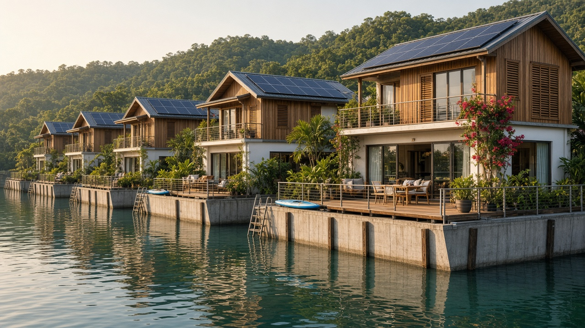

# 03. Site selection, marine environment and platform structure

*Chapter scope: where to put the seastead, what it should float on, how it is built, moored, protected and kept alive for 50 years. Shared assumptions are in [00-design-basis.md](00-design-basis.md). All costs are 2026 US dollars unless stated; escalation factors are listed in Section 7.*

## Summary

- **The engineering is not the hard part, provided the site is sheltered.** Floating reinforced-concrete caissons are routine in the Netherlands (Schoonschip, IJburg, the Rotterdam Floating Pavilion) and have been scaled to 160,000-tonne, 100-year-design-life structures (the Monaco semi-floating dyke). A two-hectare floating village in a lagoon or sheltered bay can be built with existing yards, codes and contractors.
- **Site exposure sets the cost.** Moving from sheltered host waters to an exposed exclusive economic zone (EEZ) multiplies the structural cost per square metre by roughly three to five, because the platform must either become a semi-submersible or sit behind a breakwater that costs more than the town. The high-seas archetype is not engineering-credible for Phase 1: water depths exceed the deepest mooring ever installed, and no affordable breakwater exists.
- **Cyclones: latitude is a weak proxy.** Our own count of 45 years of IBTrACS best-track data shows zero tropical storms within 300 km of Tarawa (1.4°N) and São Tomé (0.3°N), but eleven within 300 km of Funafuti (8.5°S) and thirteen near Tahiti. The design basis "±5 to 8°" rule should be tightened (Section 8).
- **Shortlist (engineering grounds only).** The Riau Islands near Batam and Bintan (Indonesia) score best, followed by the Bay/Gulf of Panama (Pacific side) and North Malé Atoll (Maldives). Tarawa lagoon has excellent weather but poor logistics. São Tomé is let down by piracy and the lack of natural shelter, and Tahiti by cyclones.
- **Reference design:** nine reinforced-concrete caissons, each 50 × 50 × 6.0 m, joined into a 150 × 150 m raft (22,500 m² gross deck, about 20,000 m² usable). Draught is about 2.9 m (range 1.9 to 3.6 m), freeboard about 3.1 m and displacement about 67,000 t, with 25 watertight cells per module. The modules are linked by semi-rigid, demountable connectors and held by 12 mooring points (piles or chain, depending on depth and tide). A floating wave attenuator of about 500 m protects the exposed sides.
- **Cost (platform, connectors, tow, mooring, attenuator, engineering and contingency, excluding buildings and utilities):** about **US$37m / $91m / $188m** (low / central / high), or **$1,800 / $4,500 / $9,400 per usable m²**.
- **Programme:** about 5 to 5.5 years from site survey to first residents (realistic range 4 to 7 years). The critical path runs through a 12-month wave-measurement campaign, model-basin testing and class approval.
- **Verdict: Amber.** The concept is feasible in sheltered host waters with significant caveats. It is Red for the high seas in Phase 1.

---

## 1. Site selection

### 1.1 Met-ocean and siting criteria

| Criterion | Why it matters | Target for Phase 1 |
|---|---|---|
| Tropical cyclone (TC) exposure | Sets the 100-year wind, waves and surge; dominates mooring and freeboard | No storm of tropical-storm strength or above within ~300 km in the record |
| Significant wave height *Hs* and period *Tp* | Governs motion comfort, connector fatigue and breakwater size | 100-yr *Hs* ≤ 1.5 m at the platform; *Tp* short (< 6 s) or swell of low height |
| Tsunami | Rapid water-level change and strong currents load moorings | Low hazard, or deep water |
| Water depth and seabed | Mooring type and cost | 10 to 60 m, sand or mud over rock suitable for piles or anchors |
| Tidal range | Pile and guide heights, chain geometry, gangways | ≤ 2 m preferred |
| Logistics | Port, airport, hospital, yard within a short boat ride | ≤ 1 h to port and hospital, ≤ 2 h to airport |
| Sea-level rise | Floating structures rise with the sea; host coast may not | Host infrastructure resilient to ~0.5 to 1 m by 2100 |
| Environment | Seabed shading, coral, wastewater rules | Sandy or muddy bottom, not live coral; discharge permitted after treatment |
| Security | Piracy and armed robbery | Low incidence |

### 1.2 Tropical cyclones

Tropical cyclones rarely develop within about 5° of the equator because the Coriolis force, which turns inflowing air into a rotating vortex, is too weak there.[^1] NOAA gives a typical minimum genesis distance of about 300 miles (480 km) from the equator.[^2] The rule has exceptions. Typhoon Vamei formed near Singapore in December 2001 with its centre at 1.5°N,[^2] the first tropical cyclone on record to form that close to the equator.[^3]

To test candidate sites against the actual record, rather than a latitude rule of thumb, we queried the NOAA NCEI International Best Track Archive for Climate Stewardship (IBTrACS v04r01),[^4] using the "since 1980" file.[^5] We counted unique storms in seasons 1981 to 2025 with tropical-nature track points inside 100 km and 300 km of each site, using the maximum sustained wind recorded while inside the radius. (Method: haversine distance, `NATURE = TS`, wind from `USA_WIND`, else `WMO_WIND`. This is our own analysis, reproducible from the public file.)

| Site (latitude) | Storms ≥ 34 kt within 100 km | Storms ≥ 34 kt within 300 km | Of which ≥ 64 kt (hurricane/typhoon) within 300 km | Max wind within 300 km (kt) |
|---|---|---|---|---|
| Bay of Panama, near Taboga (8.6°N) | 0 | 2 | 1 | 95 (Joan, 1988, ~280 km away on the Caribbean side) |
| Gulf of Fonseca, DeltaSync 2013 site (13.2°N) | 5 | 15 | 1 | 65 |
| Tarawa lagoon, Kiribati (1.4°N) | 0 | 0 | 0 | 25 (depressions only) |
| Funafuti lagoon, Tuvalu (8.5°S) | 2 | 11 | 2 | 108 |
| North Malé Atoll, Maldives (4.2°N) | 1 | 3 | 0 | 45 |
| Batam/Bintan, Riau Islands (1.1°N) | 1 | 1 | 1 | 65 (Vamei, 2001) |
| São Tomé, Gulf of Guinea (0.3°N) | 0 | 0 | 0 | none |
| Tahiti, French Polynesia (17.5°S) | 1 | 13 | 7 | 100 |
| Busan, Oceanix site (35.1°N) | 24 | 81 | 40 | 100 |

Two lessons follow. First, the South Atlantic (Gulf of Guinea) and the central equatorial Pacific are effectively cyclone-free. NOAA attributes the absence of South Atlantic and south-east Pacific cyclones to high wind shear, few disturbances and cooler water.[^1] Second, the band 5 to 9° is unsafe in the south-west Pacific. Funafuti, at 8.5°S, has seen eleven tropical storms within 300 km, and Cyclone Pam in 2015 drove damaging surges into Funafuti from the lagoon side,[^6] even though its track did not come within 300 km in our IBTrACS count. A design that is "cyclone-free" by latitude can still receive cyclone swell and surge.

### 1.3 Waves

Global altimetry puts the most energetic seas in the extratropical mid-latitudes: mean winter *Hs* reaches 4.5 to 5.0 m in the North Atlantic and 4.0 to 4.5 m in the North Pacific.[^7] Enclosed or sheltered seas, including the Indonesian archipelago, are among the regions of typically low sea state.[^8]

Wave period matters as much as height, because it controls both breakwater size and the acceleration residents feel:

- **Gulf of Panama.** This is a low-energy, swell-dominated basin. At the Gulf's entrance *Hs* is frequently below 1.0 m, with extremes of 2 to 3 m, and the Pearl Islands attenuate the energy reaching enclosed areas.[^9] Periods are long: typically 14 to 21 s, with swell above 20 s arriving every year.[^10] Long swell barely accelerates a platform (Section 3.5), but it cannot be stopped by any affordable floating breakwater.
- **Tarawa.** Under the easterly trades, deep-water *Hs* is typically below 2 m with periods under 6 s. During El Niño westerlies, waves reach 5 m or more with periods of at least 10 s. The hindcast 50-year ocean-side design wave is 6.1 m at 9.3 s, but the lagoon design wave is only 1.14 m at 4.1 s because generation is limited by fetch and depth.[^11] The western, leeward side of the atoll is the exposed flank in El Niño years.
- **What a lagoon wave does to a platform.** A TU Delft study of 60 × 60 × 6 m concrete modules found peak vertical RMS accelerations of 0.18 to 0.27 m/s² at *Hs* 1.5 m, *Tp* 6.7 s, without a breakwater. A floating breakwater cut these to 0.07 to 0.13 m/s².[^12] The no-breakwater values sit at or above the 0.02 g (0.2 m/s²) cruise-ship comfort limit (Section 3.5). **Short-period wind sea above about 1 m at the platform is the binding comfort case**, not the 100-year storm.

### 1.4 Tsunami

In the deep ocean a tsunami is usually less than 1 m high and is not noticed by ships. It becomes hazardous only as it slows and steepens in shallow water.[^13] UNESCO's Caribbean Tsunami Information Centre advises that vessels are safer in deep water (more than 100 m) than moored in a harbour, where currents are magnified.[^14] A floating town in a shallow lagoon therefore faces two specific risks: mooring overload from tsunami currents, and the water level exceeding the height of the guide piles.

The World Bank GFDRR ThinkHazard tool rates hazard as "high" when a 2 m damaging wave has a 100-year return period, and "low" when 0.5 m has a 2,475-year return period.[^15] The ratings for the candidates are:

- Panama: high[^16]
- Kiribati: high[^17]
- Maldives: medium[^18]
- French Polynesia: high[^19]
- São Tomé and Príncipe: low[^20]
- Batam and the Riau Islands: under 0.1% annual chance of a tsunami above 3 m, with a 2,500-year coastal height of about 0.1 m, per Indonesia's national probabilistic assessment.[^21]

The 2004 Indian Ocean tsunami reached the Maldives 2,500 km from its source and left watermarks up to 4 m on Vilufushi. In Malé the water rose gradually, with little structural damage.[^22] Laboratory work on very large floating structures (VLFS) under solitary waves shows that mooring force rises with structural stiffness and peaks near the onset of wave fission. This needs explicit design, not hand-waving.[^23]

### 1.5 Water depth, seabed and tide

- **Lagoon and atoll depths suit piles or short catenary moorings.** Tarawa lagoon is at most about 24 m deep and averages 8 m outside the reef flats.[^11] North Malé Atoll's interior is generally 46 to 64 m deep with a sandy bottom.[^24]
- **The Bay of Panama shelves very gently**, reaching 200 m only at its 200 km-wide mouth.[^10] It also has a large tide: spring ranges at Balboa reach about 22 ft (6.7 m), with an average of 12.6 ft (3.8 m).[^25] Guide piles and gangways must accommodate this.
- **Mooring depth limits.** Chain-and-anchor catenaries are the usual choice up to about 100 m.[^26] Deep-water moorings exist, but the deepest permanently moored floating production unit, Shell's Turritella, sits in 2,900 m.[^27] Most high-seas locations are deeper still.

### 1.6 Logistics

Construction and maintenance want a heavy-industry coast nearby. Batam alone has more than 135 maritime industries, and BP Batam's directory lists 58 shipyard and offshore companies. The Tanjung Uncang shipbuilding zone has 6 to 18 m of water and lies about 20 km from Singapore.[^28] The Maldives Floating City lagoon is about 10 minutes by boat from Malé and the international airport.[^29] Tarawa and São Tomé, by contrast, have small airports, limited hospitals and no heavy yard.

### 1.7 Sea-level rise

Relative to 1995 to 2014, IPCC AR6 projects a likely global mean rise by 2100 of 0.32 to 0.62 m (low emissions) to 0.63 to 1.01 m (very high emissions). It also notes that a rise approaching 2 m cannot be ruled out under very high emissions.[^30] A floating platform is immune to the rise itself. Its exposure is indirect:

- Guide piles and chain geometry must allow for the rise.
- Shore infrastructure (airport, port, hospital) on low atolls such as Tarawa or Malé is itself at risk. For logistics this is a strike against atoll hosts.

### 1.8 Environmental constraints

A compact floating development shades the seabed heavily. For a compact layout at 45° latitude, about 77% of the seabed under the footprint stays shaded for more than 8 hours on the equinox.[^12] Sites should therefore be over sand or mud, not live coral or seagrass. Wastewater rules can be decisive: Panama would not let the cruise-ship seastead MS Satoshi discharge even treated wastewater, which would have forced trips 12 miles offshore every few weeks.[^31]

### 1.9 The three archetypes on engineering grounds

| Parameter | (1) Sheltered host waters | (2) Exposed EEZ (12 to 200 nm) | (3) High seas (> 200 nm) |
|---|---|---|---|
| 100-yr *Hs* at platform | ~1 to 1.5 m (Tarawa lagoon 50-yr: 1.14 m / 4.1 s)[^11] | ~5 to 8 m in non-cyclone tropics (Tarawa ocean side 50-yr: 6.1 m / 9.3 s)[^11] | similar or higher, plus long swell |
| Water depth | 10 to 60 m | 50 to 3,000 m, site-dependent | typically 3,000 to 5,500 m |
| Mooring | Piles, dolphins, short chain or elastic lines | Deep catenary or taut polyester, $10 to 30m | Beyond the 2,900 m record:[^27] drift, dynamic positioning, or a seamount |
| Wave protection | Natural reef or headland, plus a light floating attenuator | Very large floating or fixed breakwater ($100 to 600m), or a semi-submersible platform | Breakwater impractical; semi-submersible only |
| Suitable structure | Concrete pontoons or caissons | Semi-submersible, or heavy pontoons behind a breakwater | Semi-submersible or ship |
| Indicative platform cost (2026, per usable m², including mooring and protection) | ~$1,800 to 9,400 | ~$12,000 to 24,000 | above EEZ, plus logistics |
| Access | Ferry, 10 to 60 min | Hours by boat | Days |
| Engineering verdict | **Green/Amber** | **Amber/Red** | **Red (Phase 1)** |

This mirrors the Seasteading Institute's own 2013 to 2014 conclusion. DeltaSync found semi-submersibles and breakwaters to be the only open-ocean options, judged breakwaters "prohibitively expensive" and designed instead for a bay inside "nature's breakwaters".[^26] The Institute's semi-submersible study, priced from a Texas shipyard bid, came out at about twice DeltaSync's cost per square foot.[^32]

### 1.10 Candidate regions and scoring

Six candidates were scored 1 (poor) to 5 (good) against the Section 1.1 criteria. The scores are judgements from the evidence cited above. Political and legal feasibility is deliberately excluded here and is scored in the legal chapter.

| Criterion (weight) | Riau Is., near Batam/Bintan (Indonesia) | Bay/Gulf of Panama, Pacific | North Malé Atoll (Maldives) | Tarawa lagoon (Kiribati) | Tahiti lagoon (French Polynesia) | São Tomé (Gulf of Guinea) |
|---|---|---|---|---|---|---|
| Cyclones (20%) | 4 (Vamei only) | 5 | 5 | 5 | 2 | 5 |
| Waves and shelter (20%) | 5 (enclosed seas)[^8] | 4 (low *Hs*, long swell) | 4 (atoll rim) | 4 (lagoon; El Niño westerlies) | 4 (barrier reef) | 2 (no lagoon) |
| Tsunami (10%) | 5[^21] | 2[^16] | 3[^18] | 2[^17] | 2[^19] | 4[^20] |
| Depth and seabed (10%) | 4 (6 to 18 m nearshore)[^28] | 4 | 4 (46 to 64 m) | 3 (shallow, patch reefs) | 3 | 2 (steep volcanic shelf) |
| Logistics (15%) | 5 (Singapore, yards) | 5 (Panama City) | 4 (Malé; no heavy yard) | 1 | 3 | 2 |
| Tide and sea-level rise (5%) | 4 | 3 (6.7 m spring tide) | 3 | 2 | 4 | 4 |
| Environment (10%) | 3 | 3 | 2 (coral) | 3 | 2 | 3 |
| Security (10%) | 3 (Singapore Strait robbery) | 4 | 5 | 5 | 5 | 1 (2025 hijacking, kidnappings) |
| **Weighted score (/100)** | **85** | **80** | **79** | **67** | **61** | **58** |

Notes on the scoring:

- **Riau Islands.** This option combines a cyclone-free (bar Vamei), low-wave, very-low-tsunami setting with Asia's densest offshore construction cluster. The catch is shipping density and petty piracy: the Singapore Strait accounted for 80 incidents, over 58% of the global total, in 2025.[^33]
- **Panama.** A world-class logistics hub with almost no cyclone risk. The penalties are its high tsunami rating and very large tide.
- **North Malé Atoll.** This is where the Maldives Floating City is going (Section 1.11). It is an excellent lagoon, but coral-sensitive, and the host islands face the most sea-level-rise exposure.
- **Tarawa.** It has the best weather in the table, but is remote, and the host atoll is itself at risk.
- **São Tomé.** It is cyclone-free and has low tsunami risk, but offers no lagoon. In 2025 a tanker was hijacked 37 nm from the islands and ten crew kidnapped.[^33]
- **Tahiti.** A Seasteading Institute memorandum of understanding was voided in 2018 after local opposition to the Atimaono lagoon site,[^34] and the cyclone record is poor.
- **Excluded sites.** Funafuti (Tuvalu) fails on cyclones. The Gulf of Fonseca (DeltaSync's 2013 site) sits in the eastern Pacific storm belt, and tropical storms there have driven waves of around 3 m.[^26]

### 1.11 Where the two flagship projects sited, and why

- **Maldives Floating City (Dutch Docklands with the Government of Maldives, master plan by Waterstudio).** It occupies a 200-hectare lagoon about 10 minutes by boat from Malé and the airport.[^29] The lagoon was chosen because a ring of barrier islands and reefs breaks the waves, removing the need for land reclamation.[^35]
  - The plan is reported at about US$1 billion for some 5,000 units, sited at a lagoon near Aarah, Kaafu Atoll.[^36] In 2022 the developer said a large part of the structure had been completed at Thilafushi for assembly in the lagoon, and that shipping 1,400 containers to the Maldives was the main logistics challenge.[^36]
  - Delivery has been slow. A 2023 freedom-of-information reply said no work had started on the five allotted lagoons, two of which had been sold on.[^37] By 2025 the designers said the first section, manufactured in Sri Lanka, had been shipped to the site.[^38]
  - Units are reportedly fixed to a submerged concrete hull "screwed to the seabed on telescopic steel stilts".[^39]
- **Oceanix Busan (Oceanix, BIG and SAMOO, with UN-Habitat).** The plan is three interconnected platforms totalling 6.3 ha, linked to land by link-span bridges.[^40] BIG chose the site because it is "close to the city, yet has relatively deep water".[^41] Busan was attractive for its deep harbour and gentle tides,[^42] and its major shipbuilders.[^43]
  - Busan is squarely in typhoon country (Section 1.2: 40 typhoon-strength storms within 300 km since 1981). Oceanix's answer was a protected harbour site ("Busan is very well protected") and a design target of Category 5 storms.[^43]
  - By August 2025 the Busan Ilbo reported that the site was moving from North Port Phase 1 to Phase 2, that the budget was US$600 million, and that the city had still not heard how Oceanix would fund it.[^44] BIG lists the project as "In Design".[^41]

**Both flagships sited in sheltered water next to a major city and port** (a capital in the Maldives, Korea's main container port in Busan). That is the strongest available signal of where professional floating-city developers think the engineering, finance and insurance close.

---

## 2. Platform concept options

### (a) Modular reinforced-concrete pontoons (caissons)

- **Dutch practice.** A hollow, cast-in-one-piece concrete tub carries a light timber or steel house. Hercules Floating Concrete cast practically all of Schoonschip's floats, for 46 households on 30 lots, on land next to the water because they were too big for the traditional ark-builders' dry docks. The heaviest house weighs 340 t.[^45] The Schoonschip homes cost €300,000 to €800,000, about 20% more than comparable homes on land,[^46] and each is held by two vertical poles.[^47] At IJburg, 55 floating houses sit on concrete tubs submerged about half a storey, cast as a unit "to avoid maintenance-sensitive seams".[^48]
- **Rotterdam Floating Pavilion.** Here a concrete shell was preferred over EPS-concrete, steel pontoons and fibre-reinforced plastic on grounds of lifespan, maintenance and stability. Steel pontoons were scored as needing "a lot of maintenance".[^49] Its floating island is 46 × 24 m (1,104 m² gross floor area).[^50]
- **Cost.** Dutch practice now budgets about €600/m² for a concrete float in sheltered inland water.[^51] DeltaSync's 2013 seastead estimate was €1,100 to 1,300/m² for 50 × 50 m marine caissons, based on €1,400/m³ of concrete. Including moorings and three-storey buildings, it came to $15.2m per platform, or $504 per ft² of usable space.[^26][^52]
- **Assessment.** Wave tolerance is limited to sheltered water: comfortable to about *Hs* 1 m in short-period seas for 50 to 60 m modules, with survival limited by freeboard. Design life of 50 to 100 years, low maintenance, excellent expandability.

### (b) Steel very large floating structure (VLFS)

- **Mega-Float.** Japan's Mega-Float test runway (1995 to 2001 programme, 17 shipbuilders and steelmakers) was a welded steel box 1,000 m long, 60 to 121 m wide and 3 m deep.[^53] It covered 8.5 ha and was moored in about 20 m of water in Yokosuka Bay. Units were joined afloat, with prestressing-tendon jigs among the methods developed.[^54] It cost about $170 million.[^55] VLFS research since then has focused on hydroelastic response, mooring and structural integrity.[^56]
- **Shirashima.** The closest long-running precedent is Japan's Shirashima national oil stockpile. Eight double-hulled steel storage barges, each 397 × 82 × 25.4 m, have floated inside a 60-ha breakwater-protected basin since 1996.[^57]
- **Assessment.** Wave tolerance similar to concrete, but the lighter, flexible hull responds hydroelastically. About $3,500 to 4,000/m² in 2026 money (Section 7). Steel needs coatings, cathodic protection and regular survey. Expandable by welding, but less modular than concrete.

### (c) Semi-submersible platforms

Columns carry the deck above the waves while buoyancy sits deep below them, giving small waterplane area and long natural periods.

- **The Seasteading Institute's 2013 study.** George Petrie's semi-submersible design (180 units, about 360 people) was priced at $225.5m total capital cost, including a $115.5m hull and deck bid and a $15m mooring. That is $978 per ft² (about $10,500/m²) of residential and commercial space.[^32]
- **ClubStead.** The Institute's 2009 design by Marine Innovation & Technology was a 400 × 400 ft cable-stayed four-column platform for 270 people. It had a 75 ft draught, was costed at $114.3m (steel at $5,000/t), and came to $715 per ft² of footprint.[^58][^59] Its column footings were designed to increase the natural heave period.[^60]
- **Concrete precedent.** Concrete semi-submersibles exist: Troll B is a floating platform with a concrete substructure.[^61]
- **Assessment.** Survives open-ocean storms and stays comfortable in several metres of sea. About $12,000 to 15,000/m² (2026). Steel life of 25 to 50 years with a heavy maintenance load. A fixed deck footprint gives poor expandability.

### (d) Converted or purpose-built ship

- **MS The World**, the only operating residential ship, cost $262m on contract in 1999.[^62] It has 165 residences, 43,188 gross tonnage, and about 300 crew for 150 to 200 residents and guests.[^63]
- **Conversion is cheap to buy but hard to operate as a stationary home.** Ocean Builders bought the 1991 cruise ship Pacific Dawn (renamed MS Satoshi) to anchor off Panama. They could not obtain protection and indemnity insurance for "a stationary residential cruise ship", lost the path to crew, class and flag, and sold her within weeks.[^64] Panama also refused to treat the ship as non-seagoing.[^65]
- **Freedom Ship**, a 1.8 km linked-barge city proposed in the late 1990s and estimated at $6bn in 1999, has never been funded; estimates have since risen to $15 to 20bn.[^66]
- **Maintenance.** Ships face two bottom surveys every five years, normally in dry dock.[^67]
- **Assessment.** Open-ocean capable, but motion at anchor is poor for a home. No gardens or "land", short economic life, no expandability.

### (e) Spar or SeaPod-type individual homes (Ocean Builders)

- **Configuration.** A 73 m² living pod sits on a steel tripod spar 2.2 m above the waves. The spar is 12 to 15 mm marine steel with zinc and "active electric protection", inspected monthly.
- **Wave performance (developer's own guidance):**
  - Motion is minimal up to 1.5 m waves.
  - From 2 to 3 m it is "manageable but not good for long-term living".
  - The structural maximum is 5 m.
  - The claimed life is 50 years with maintenance.[^68]
- **Cost.** Prices have been reported at $295,000 to $1.5m per pod, or about $4,000 to 20,000/m².[^69]
- **Assessment.** Elegant for single dwellings, but it creates no shared ground for gardens, school or plaza. It suits a marina fringe, not the town itself.

### (f) Hexagonal modular platforms (Oceanix)

Oceanix proposes 2-ha hexagonal "neighbourhoods" for up to 300 residents, clustered six around a sheltered harbour.[^70] The floats are hollow concrete caissons.[^71] Its co-founder has been frank that salt "will get to your rebar", and that stainless or fibre reinforcement is being considered.[^43] Technically this is option (a) with a geometry that packs efficiently and can wrap a protected inner basin. Its cost remains unproven: $200 to 220m was claimed in 2021 to 2023,[^43] and $600m was reported in 2025 for 6.3 ha.[^44]

### Options compared

| Option | Comfortable *Hs* (indicative) | Survival setting | Deck cost 2026 $/m² | Design life | Maintenance | Expandability |
|---|---|---|---|---|---|---|
| (a) Concrete caissons | ≤ 1 to 1.5 m short-period | Sheltered water | 700 to 3,500 (hull only) | 50 to 100 yr | Low | High |
| (b) Steel VLFS | ≤ 1 to 1.5 m | Sheltered water | 3,500 to 4,000 | 30 to 50+ yr | Medium-high (coatings, cathodic protection) | Medium |
| (c) Semi-submersible | several metres | Open ocean | 12,000 to 15,000 | 25 to 50 yr | High | Low |
| (d) Ship | ~1 to 2 m at anchor | Open ocean (underway) | n/a (~$3m per residence for The World, escalated) | 25 to 35 yr | High (dry-docking) | None |
| (e) SeaPod spar | ≤ 1.5 m (2 to 3 m tolerable) | Up to 5 m waves (claimed) | 4,000 to 20,000 (per living m²) | 50 yr claimed | Monthly inspection | Unit by unit |
| (f) Oceanix hexagons | as (a) | Sheltered water | unproven | as (a) | as (a) | High |

---

## 3. Recommended concept and reference design

*AI-generated impression, not a design drawing.* Waterfront homes along the outer edge. The concrete hull wall in the foreground stands about 3 m above the water, matching the reference design's freeboard of about 3.1 m.

### 3.1 By archetype

- **Sheltered host waters (recommended):** modular concrete caissons (a), arranged compactly as in (f). Pile or short-chain mooring, plus a light floating wave attenuator on the fetch-facing sides.
- **Exposed EEZ:** either a cluster of semi-submersibles (c), or option (a) built deeper and heavier behind a Monaco-type deep-draught breakwater. Both cost three to five times more per m² (Section 7).
- **High seas:** a semi-submersible (c) or ship (d) only, with dynamic positioning or drifting. Not recommended for Phase 1.

### 3.2 Module size and layout

Larger modules move less and need fewer connectors. Smaller ones fit more yards and are easier to tow and replace. DeltaSync concluded that the ideal range was 45 to 75 m and chose 50 × 50 m.[^26] TU Delft's 2025 study used 60 × 60 × 6 m.[^12] We adopt **nine 50 × 50 m modules in a 3 × 3 grid (150 × 150 m)** for four reasons:

- They fit common graving docks. The 380 × 75 m Algeciras basin used for Monaco would take six or seven per cycle.[^72]
- Nine units allow three construction batches and redundancy.
- A square cluster minimises perimeter, and so the length of wave attenuator needed.
- About 2,500 m² of gross deck is lost to edges, connector strips and hatches, leaving roughly 20,000 m² usable.

### 3.3 Weights, buoyancy, draught and freeboard (one module, 50 × 50 × 6.0 m, 25 cells of 10 × 10 m)

**Hull concrete (judgement-level sizing, to be replaced by structural design):**

| Element | Dimensions | Volume (m³) |
|---|---|---|
| Bottom slab | 0.30 m × 2,500 m² | 750 |
| Deck slab | 0.25 m × 2,500 m² | 625 |
| Perimeter walls | 0.35 m × 5.3 m × 200 m | 371 |
| Internal bulkheads (4 each way at 10 m) | 0.20 m × 5.3 m × 400 m | 424 |
| Haunches, beams, hatches, connector blocks (+10%) | | 217 |
| **Total** | | **≈ 2,390 m³** |

At 2.45 t/m³ the hull weighs ≈ 5,850 t (2.3 t/m²). With lightweight-aggregate concrete of about 2.0 t/m³, as used on Heidrun and the WWII concrete ships, it drops to ≈ 4,800 t. The TU Delft 60 m benchmark implies 1.14 t/m².[^12] **Central assumption: 2.2 t/m² (5,500 t).**

**Topside dead loads across the cluster (design basis land uses):**

| Use | Area or quantity | Assumed load | Tonnes |
|---|---|---|---|
| 25 houses | 6,250 m² floor | 0.6 t/m² floor (light timber or steel frame, finishes, services) | 3,750 |
| Communal buildings | 3,000 m² floor | 0.6 t/m² | 1,800 |
| Utilities, batteries, tanks | 800 m² | plant plus ~500 m³ fresh water | 900 |
| Food production | 2,000 m² | mixed hydroponics and beds | 1,000 |
| Private gardens | 2,500 m² | 0.4 m saturated soil ≈ 0.72 t/m² | 1,800 |
| Public open space | 5,000 m² | half planted (0.5 t/m²), half paved (0.15 t/m²) | 1,625 |
| Circulation | 2,500 m² | 0.15 t/m² | 375 |
| Pool | ~375 m³ | water | 375 |
| Marina edge fittings | | allowance | 400 |
| **Total** | | | **≈ 12,000 t (0.53 t/m² averaged over 22,500 m²)** |

**Per-module buoyancy check:**

| Item | Tonnes |
|---|---|
| Hull | 5,500 |
| Hull outfitting (ballast and bilge, pipes, insulation), 0.1 t/m² | 250 |
| Topsides, 12,000 / 9 | 1,336 |
| Variable load (people, stores, contents), 0.15 t/m² | 375 |
| **Displacement Δ** | **7,461** |

- **Draught** T = Δ / (ρ × A) = 7,461 / (1.025 × 2,500) = **2.91 m**. The range is 1.9 m with a light hull to 3.6 m with a heavy hull. **Freeboard is 6.0 − 2.91 = 3.1 m.** If detailed design lands at the heavy end, deepen the hull to 6.5 m to hold at least 3 m of freeboard.
- **Cluster displacement** is about 67,000 t. **Reserve buoyancy** is about 7,900 t per module, roughly 106% of displacement.
- **Damage case.** Flooding one 10 × 10 m cell (4% of the waterplane) sinks an isolated module by about 0.12 m.
- **Interior space.** Each hull has about 13,000 m³ of internal volume. This can take fresh-water storage, pumps, wastewater plant and stores, which frees deck area.

### 3.4 Stability (isolated module: the worst case, as during tow)

- **Metacentric height.** The waterplane term is BM = B² / (12T) = 2,500 / 34.9 ≈ 71.6 m, and KB = 1.46 m. The centre of gravity, weighting the hull at 2.4 m, outfitting at 3 m, topsides at 9 m and variable load at 8 m, is KG ≈ 3.9 m. That gives **GM ≈ 69 m**: a flat box is enormously stiff in roll.
- **Wind heel.** The TU Delft criterion is a 540 Pa wind (about 30 m/s), with heel not to exceed half the freeboard and a range of stability of at least 20°.[^12] A 540 Pa wind on roughly 400 m² of lateral area at a lever of about 5 m heels the module by about 0.01°.
- **Crowd heel.** A crowd of 500 people at one edge (37.5 t at 20 m) heels it by about 0.08°.
- **Damage heel.** A flooded corner cell heels it by about 0.7°.
- All three are far inside a 2° habitability limit.[^73] **Static stability is not a design driver. Dynamics, connectors and moorings are.**

### 3.5 Motions and habitability criteria

No code yet sets motion limits for floating towns. TU Delft notes that "no guidelines exist" and borrows from ISO 6897 and from NORDFORSK seakeeping criteria.[^12] We propose to design against the following.

| Source | Criterion |
|---|---|
| NORDFORSK 1987, via Riola and García de Arboleya | Vertical RMS acceleration 0.02 g (≈ 0.2 m/s²) for cruise-liner passengers; 0.05 g for ferries[^74] |
| PIANC Australia (floating pontoons) | Comfort: vertical RMS 0.02 g, lateral RMS 0.03 g; peak tilt 6°[^75] |
| HAN/Blue21 study for floating islands | < 0.15 m/s² at 0.1 to 1 Hz (seasickness band); < 0.7 m/s² below 0.1 Hz; < 0.14 m/s² above 1 Hz; static heel < 2°[^73] |
| ISO 2631-1 / 2631-2 | Motion sickness dose value method; ISO 2631-2 covers buildings at 1 to 80 Hz but gives no acceptable magnitudes[^76] |
| ISO 6897 / BS 6611 | Low-frequency horizontal motion, 0.063 to 1 Hz, in buildings and offshore structures[^77] |

**Proposed project criteria (judgement):**

- Vertical RMS acceleration ≤ 0.10 m/s² in the 1-year sea state.
- Vertical RMS acceleration ≤ 0.20 m/s² in the 10-year sea state.
- Horizontal motion within ISO 6897 curves for residential buildings.
- Static heel ≤ 1° in normal use and ≤ 2° under the 100-year wind.

**Rough motion arithmetic:**

- **Long swell (Panama).** A platform much smaller than the wavelength rides the wave. For a narrow-band sea, RMS vertical acceleration ≈ ω² × *Hs*/4. At *Hs* 1.0 m and *Tp* 16 s, ω = 0.39 rad/s, giving a_rms ≈ 0.04 m/s². Even a 3 m extreme at the same period gives only about 0.12 m/s². Long-period swell is therefore a comfort non-issue at the heights recorded in the Gulf of Panama.[^9]
- **Short wind sea (lagoon).** A single 50 m module has an estimated heave natural period of about 7 to 8 s. (Added mass is taken as roughly 0.24 ρB³, a rough flat-plate approximation.) That sits inside the wind-sea band, which is consistent with TU Delft's 0.18 to 0.27 m/s² at *Hs* 1.5 m.[^12] Joining nine modules into a 150 m raft lifts the estimated period to about 12 to 13 s and averages out waves shorter than the raft. A floating attenuator with transmission coefficient Ct ≈ 0.5 halves *Hs* and so roughly halves accelerations, to about 0.09 to 0.14 m/s².
- **Conclusion.** In a lagoon with 100-year *Hs* of about 1.5 m, the reference design should meet the proposed criteria with connectors and an attenuator. **This must be confirmed by diffraction analysis and model-basin tests** (Section 5).

### 3.6 Connectors between modules

There are three options:

- **Rigid.** Post-tensioned or welded joints, as on the Mega-Float.[^54] This gives the best comfort, but the joints must carry the full global bending.
- **Hinged or flexible.** Steel links plus elastomeric fenders. Loads are lower, but there is relative motion at every joint, which affects pipes, cables and pedestrians.
- **Separate islands linked by bridges** (DeltaSync's "branch" concept).[^26] Most flexible, worst comfort.

TU Delft found that, without a breakwater, the dynamic RMS bending moment at rigid connectors exceeds the still-water bending moment, and that a breakwater reduces it substantially.[^12]

**Recommendation: semi-rigid, demountable joints.**

- Concrete shear keys with elastomeric bearings, clamped by post-tensioned high-strength bars in accessible galleries. These can be de-tensioned to release a module for repair or relocation.
- Twelve internal edges, each with three to four connector units.
- Flexible utility crossings, plus fatigue-rated design for 50 years of wave cycles.

### 3.7 Breakwater: physics and options

**Physics.** A floating breakwater works only if it is wide compared with the wavelength L. In deep water L = gT²/2π ≈ 1.56 T² (L in m, T in s). A rule of thumb from lab data is that transmission Ct ≈ 0.3 at L/W = 3 and 0.9 to 1.0 at L/W = 8.[^78] PIANC guidance is that floating breakwaters are not recommended where wave periods exceed 4 to 5 s.[^79] DeltaSync cites a minimum width of 0.3 L to halve wave height (Ct < 0.5) for an anchored unit.[^26]

**Lagoon (reference case).** With T = 4.1 s, L ≈ 26 m, so a pontoon about 10 to 12 m wide with 3 to 4 m draught gives Ct ≈ 0.3 to 0.5.

- Cover two windward sides plus returns: about 500 m.
- It can double as the marina edge and a ship-impact buffer.
- FDN's 2013 reference prices for floating breakwaters were €3,000/m for *Hs* < 1.1 m, €5,000/m for *Hs* 1.1 to 2.5 m and €10,000/m for heavier duty.[^26] That is about **$5,000 to 15,000/m in 2026 money, or $2 to 10m for 500 m.**

**Exposed EEZ.** With T = 10 to 14 s, L = 150 to 300 m, and a floating breakwater would have to be 50 to 150 m wide: effectively a second platform.

- DeltaSync priced an open-ocean floating breakwater at €108,000 to 135,000 per metre in 2013.[^26]
- **Monaco's semi-floating dyke** is the only built deep-water analogue.[^72]
  - Dimensions and weight: a 352 × 28 m prestressed caisson with a 16 m draught and 8 m stabilising fins, weighing 163,000 t.
  - Performance: designed for 100-year *Hs* 4.9 m, it transmits less than 0.2 of the incident swell.[^72]
  - Mooring: held by a ball joint and chains to piles in 72 to 75 m of water.[^80]
  - Cost: €120m, about half the cost of a rubble-fill jetty.[^81] That is about **$640,000 per metre in 2026 money**.
- A 500 to 900 m arc around the reference raft would cost **$100m to over $500m**, several times the platform itself.

**Fixed rubble mound on a bank.** A conventional rubble-mound breakwater in 15 m of water cost about €16 to 17.5m per km in a 2005 optimisation study, roughly $28,000 to 31,000 per metre today.[^82] In exposed deep water, costs of $10,000 to 100,000 per running metre (1987 dollars, about $29,000 to 290,000 today) were typical.[^83] This option is only plausible on a shallow bank, with a large environmental footprint.

### 3.8 Mooring system

| Type | Depth | Suits | Notes |
|---|---|---|---|
| Guide piles or dolphins with sliders | ≤ ~30 m | Lagoon, large tide | Dutch practice (two poles per house at Schoonschip);[^47] EN 14504 "Option B" guides;[^84] guide height must allow tide, surge, tsunami and sea-level rise |
| Short catenary chain or elastic synthetic lines to pile or drag anchors | 10 to 100 m | Lagoon, sheltered bay | Common choice to ~100 m;[^26] tolerates moderate tide |
| Taut polyester or chain-polyester | 50 to 3,000 m | Exposed EEZ | A floating-wind line costs about $366,000 to 375,000 excluding anchors (2022, 60 to 100 m);[^85] the Seasteading Institute's 2013 semi-submersible mooring was $15m[^32] |
| Tension-leg tethers | 100 m+ | Semi-submersible or tension-leg platform | Heidrun's concrete tension-leg platform: 350 m depth, 50-year service life[^86] |

**Reference lagoon mooring loads (our estimate, 100-year, non-cyclonic site):**

| Load | Basis | Force |
|---|---|---|
| Wind | 30 m/s on ~1,200 m² projected area, Cd 1.2 | ≈ 0.8 MN |
| Current | 1 m/s on 435 m² frontal area | ≈ 0.2 MN |
| Mean wave drift | Full-reflection bound, (1/16) ρ g *Hs*² × 150 m at *Hs* 1.5 m | ≈ 0.2 MN |
| **Mean total** | | **≈ 1.2 MN** |

- With a dynamic factor of 2, about 2.5 MN must be resisted with redundancy.
- **Twelve lines or pile guides** (three per side) with line breaking loads of a few meganewtons do this. That is an order of magnitude below a floating-wind mooring line.
- Cost: about $2 to 12m (Section 7).
- **Panama:** with a 6.7 m spring tide,[^25] choose elastic lines or tall guide piles.
- **Exposed EEZ:** the same arithmetic at *Hs* 6 m and 40 m/s wind gives a mean of about 5 MN and dynamic peaks of around 15 MN, so floating-wind-class lines would be needed at $10 to 30m.

---

## 4. Durability

**Concrete in seawater**

- **Standard.** DNV-ST-C502 covers floating and fixed offshore concrete.[^87][^88] For a 50-year design life it requires minimum covers of:
  - 60 mm (corrosion-sensitive reinforcement) or 50 mm (slightly sensitive) in the tidal and splash class XS3;
  - 70 mm or 60 mm respectively for 100 years.
- **Mix.** The water-to-binder ratio is limited to 0.45 generally and 0.40 in the splash zone, with at least 400 kg/m³ of cement in the splash zone.[^87]
- **Monaco's choices for its 100-year life:**[^72]
  - 55 mm cover on rebar in sea-facing walls and 100 mm on prestressing ducts;
  - crack-width limits of 0.2 mm in tidal zones;
  - sacrificial-anode cathodic protection, with electrical continuity through the ducts.
- **Fibre reinforcement.** DNV-ST-C502 also includes requirements for fibre-reinforced polymer bars, the route Oceanix has floated.[^87][^43]
- **Recommended specification:** 70 mm cover, w/b ≤ 0.40 throughout, a crack-control design, stainless or fibre bars in the splash band, and embedded corrosion monitoring.

**Track record**

- **WWII concrete ships.** Ten 1920 to 1945 concrete ships still serve as a floating breakwater at Powell River, British Columbia. After 55 to 80 years their lightweight concrete remained in "generally good condition". Spalling occurred where cover was thin or the hull had structural cracks.[^89] The Second World War produced 24 concrete ships and around 80 concrete barges.[^90]
- **Offshore concrete:**
  - The Ekofisk tank, the first offshore concrete structure, was installed in 1973 and served for over 30 years.[^91]
  - Troll A's concrete substructure was built for a 70-year life.[^61]
  - Hibernia was designed for a maintenance-free 30-year life.[^92]
  - Heidrun's floating concrete hull was specified for 50 years.[^93]
- **Lesson.** Durability is governed by cover, cracking and quality control, not by concrete as such.

**Steel elements** (connectors, chains, fittings, any steel option)

- Measured tropical splash-zone corrosion of bare carbon steel was 0.25 to 0.68 mm per year at Lumut, Malaysia, well above temperate code values.[^94]
- DNV-RP-B401 gives the sacrificial-anode cathodic protection design method. Anode life should normally match the structure's life, because retrofitting is costly.[^95]
- One industry guide recommends a 1.0 mm corrosion allowance for mooring chain in tropical splash zones.[^96]

**Biofouling.** Without site data, DNV design guidance for offshore West Africa assumes 100 mm of hard-equivalent marine growth from the lowest tide to 50 m depth and 300 mm in the splash zone.[^97] This adds weight, drag and mooring load, and obscures inspection. The plan should include periodic cleaning of hull sides, connectors and chain.

**Inspection without dry-docking.** Concrete caissons are not dry-docked. Class and statutory practice for offshore units requires two bottom surveys in five years, and permits underwater inspection in lieu of dry-docking (UWILD) by diver or ROV under surveyor supervision.[^67]

| Interval | Activity |
|---|---|
| Continuous | Corrosion and chloride sensors, strain gauges at connectors, tank and cell level alarms |
| Monthly | Topside visual inspection of hatches, joints and fenders |
| Annual | ROV or diver survey of hull bottom and sides; anode potentials; mooring top-chain inspection |
| Every 5 years | Full UWILD, including cores and cover meters at splash-band hotspots, connector bar re-tensioning and anode replacement as needed; also ROV inspection of all mooring lines |
| Year 25 | Major life-extension review |
| Contingency | Detachable modules allow one to be towed to a yard if ever needed |

---

## 5. Construction and delivery

**Construction method**

- **Casting location.** Modules are cast in a graving dock or casting basin, floated out, and either towed or carried on a heavy-transport vessel.
- **Precedents:**
  - Monaco's caisson was cast in a 380 × 75 m dock at Algeciras. The dock was flooded and the dyke towed out.[^72]
  - Hibernia's base was cast in an earthen dry dock, floated and completed afloat.[^98]
  - France's Floatgen concrete floater (36 m square, about 5,000 t) was cast on three coupled barges in Saint-Nazaire.[^99]
  - Schoonschip's floats were poured on land beside the water.[^45]
- **Superstructure.** Houses can be prefabricated and placed on the modules either at the yard or at the site.

**Candidate builders and regions**

| Region | Relevant capability |
|---|---|
| Netherlands | Hercules Floating Concrete, FDN and Dura Vermeer: floating homes, the Floating Pavilion, the Monaco design[^45][^50] |
| Spain | Dragados: the Monaco dyke at Algeciras[^72] |
| France | Bouygues Travaux Publics: Floatgen[^99] |
| South Korea | Hyundai and Samsung Heavy Industries, cited as interested in floating infrastructure[^43] |
| Singapore and Batam | A dense cluster of shipyards and offshore fabricators[^28] |
| Sri Lanka | Built the first Maldives Floating City section[^38] |

For a Riau or Panama site, a temporary local casting basin is an alternative to an ocean tow.

**Tow logistics**

- A 50 m module drawing about 1.5 to 2.0 m with its hull empty can be towed in trains of two or three. A long-distance tow must be scheduled and warranted against tow-route weather.
- Alternatively, the largest semi-submersible heavy-lift ship has a 275 × 70 m deck rated for over 110,000 t. It carried the 80,500 t Moho Nord unit from Korea to Gabon.[^100] It could take four or five bare modules per voyage.
- For context, Monaco's 163,000 t dyke took 12 days to tow from Algeciras.[^80]

**Classification route.** DNV's rule set for "floating infrastructure installations" (DNV-RU-OU-0571) gained an accommodation notation, HAB, in 2023.[^101] The European standard for floating establishments is EN 14504.[^84]

**Gantt-style programme** (months from notice to proceed; ■ = active)

| Phase | 0–6 | 6–12 | 12–18 | 18–24 | 24–30 | 30–36 | 36–42 | 42–48 | 48–54 | 54–60 | 60–66 |
|---|---|---|---|---|---|---|---|---|---|---|---|
| Host agreement and site confirmation (legal chapter) | ■ | ■ | | | | | | | | | |
| Met-ocean campaign (≥ 12-month wave buoy), bathymetry, geotechnics, ecology baseline | ■ | ■ | ■ | | | | | | | | |
| Concept design and class approval in principle | | ■ | ■ | | | | | | | | |
| Basin model tests, front-end engineering design (FEED), class design approval | | | ■ | ■ | ■ | | | | | | |
| Environmental impact assessment and permits | | | ■ | ■ | ■ | | | | | | |
| Yard tender, contract, mobilisation | | | | | ■ | ■ | | | | | |
| Module construction (3 batches of 3) | | | | | | ■ | ■ | ■ | ■ | | |
| Mooring and attenuator installation | | | | | | | | ■ | ■ | | |
| Tow and installation (per batch) | | | | | | | | ■ | ■ | ■ | |
| Connection, hook-up, utilities commissioning | | | | | | | | | ■ | ■ | |
| Superstructure and house fit-out | | | | | | | | ■ | ■ | ■ | ■ |
| **First occupation** | | | | | | | | | | ■ | ■ |

Realistically, first residents arrive in year 5 to 5.5, with a range of 4 to 7 years. The comparators suggest slippage is the norm. Oceanix Busan, agreed in 2021, was still "in design" in 2025.[^41][^44] The Maldives Floating City agreement dates from 2010, and its first mock-up unit was installed in 2023.[^36][^37]

---

## 6. Survivability and safety

**100-year design storm**

- Moorings, connectors and the attenuator are designed for the site's 100-year wind, waves, current and water level. Water level means highest astronomical tide plus surge, plus a sea-level allowance of at least 0.5 m over 50 years.
- The 3 m freeboard and short-period lagoon waves keep green water off the deck.
- **Residual risks:**
  - A Vamei-type equatorial anomaly at Riau or Singapore.
  - Cyclone swell from distant storms, as at Funafuti.[^6] A rule for evacuation beyond design is needed (below).

**Tsunami**

- In deep water the platform is safe.[^13][^14]
- In a lagoon the platform rises with the water. The hazards are current-induced mooring overload and pile overtopping.
- Mitigations:
  - Size guide piles or line scope for tsunami water-level change.
  - Fit weak links or controlled-release points so that an overloaded mooring fails gracefully rather than progressively.
  - Use the tsunami warning service for muster.

**Damage stability**

- 25 watertight cells per module mean each cell holds about 4% of the module's buoyancy. That exceeds EN 14504's minimum of three watertight chambers[^84] and local float-home rules capping any compartment at 20%.[^102]
- Design for two adjacent cells flooded in any module, for example from a corner collision. That gives sinkage of about 0.25 m and heel of about 1.3° for an isolated module.
- Fit bilge alarms in every cell.
- Keep at least 500 m from navigation channels (judgement).

**Fire**

- Each module is a fire compartment, and houses are sprinklered.
- Codes offer benchmarks:
  - British Columbia's float-home standard: NFPA 13D sprinklers, or non-combustible walkways with standpipes. It also requires designers to consider flooding from firefighting water.[^103]
  - Portland: 10 ft between floating homes, or 6 ft with sprinklers or one-hour walls.[^104]
- Firefighting water must drain overboard, not into the hull. An open caisson can sink under its own extinguishing water.[^105]
- Provide fire pumps and seawater mains on two separate modules.
- Lithium battery rooms belong on deck in separated enclosures, not in hull cells (see the systems chapter).

**Evacuation**

- Muster areas on at least two separate modules.
- Enough boats and life rafts for everyone aboard (150 people plus 50% margin), with a shore-run time of 10 to 30 minutes in sheltered sites.
- A written rule for when to evacuate beyond design conditions: a named storm forecast within 300 km, a tsunami warning for the site, or loss of two mooring lines.

---

## 7. Cost data (for reuse in the cost chapter)

**Escalation assumptions (approximate, from US CPI-U[^106] and Eurostat HICP,[^107] author's estimates):**

- US dollars to 2026: 1987 ×2.9, 1999 ×1.98, 2002 ×1.83, 2009 ×1.54, 2013 ×1.42, 2022 ×1.13.
- Euros to 2026: 2002 ×1.63, 2005 ×1.52, 2006 ×1.48, 2013 ×1.33, 2025 ×1.02.
- Exchange rate: $1.15 per €.

Construction costs have outpaced CPI since 2020, so these escalations are, if anything, low.

| Item | Original figure | Source year | Approx. 2026 USD | Notes |
|---|---|---|---|---|
| DeltaSync 50 × 50 m concrete platform structure | €1,100 to 1,300/m² (€3.24m per 2,500 m²); concrete at €1,400/m³ | 2013 | $1,700 to 2,000/m²; $2,140/m³ | Includes cables and sewers; excludes VAT[^26] |
| DeltaSync complete platform incl. moorings and 3-storey buildings | $15.2m per platform; $504/ft² usable | 2013 | ~$21.6m; ~$7,700/m² usable | Seasteading Institute Floating City Project[^52][^32] |
| DeltaSync mooring / connection / bridge | €37,500 per platform / €70,000 per connection / €330,000 per bridge | 2013 | $57k / $107k / $505k | Sheltered bay[^26] |
| DeltaSync open-ocean floating breakwater | €108,000 to 135,000 per metre | 2013 | $165,000 to 207,000/m | Concept estimate[^26] |
| FDN floating breakwater blocks | €3,000 / €5,000 / €10,000 per metre | 2013 | $4,600 / $7,650 / $15,300 per metre | For *Hs* < 1.1 / 1.1–2.5 / > 2.5 m[^26] |
| Dutch concrete float ("drijfbak"), inland | ~€600/m² | 2025 | ~$700/m² | Float only; excludes buildings and anchoring[^51] |
| Dutch open caisson (thesis rule of thumb) | ~€200/m² | 2006 | ~$340/m² | Small inland arks; dated[^105] |
| Schoonschip floating home | €300,000 to 800,000 per home; ~20% premium over land | 2019 to 2023 | n/a | Sale price incl. house[^46] |
| Seasteading Institute semi-submersible (Petrie) | $225.5m; $978/ft² ($10,500/m²) | 2013 | ~$14,900/m² | Includes $15m mooring[^32] |
| ClubStead semi-submersible | $114.3m; $715/ft² of footprint | 2009 | ~$11,800/m² of footprint | Includes hotel buildings[^58][^59] |
| Mega-Float steel VLFS (8.5 ha) | ~$170m | 1999 to 2001 | ~$3,500 to 4,000/m² | Test runway, Tokyo Bay[^55][^54] |
| Monaco semi-floating dyke (352 m) | €120m | 2002 | ~$225m; ~$640,000/m | 100-year life, *Hs*100 4.9 m[^81][^72] |
| Rubble-mound breakwater, 15 m depth | €16.2 to 17.5m/km | 2005 | ~$28,000 to 31,000/m | Optimisation study[^82] |
| Rubble-mound breakwater, deep exposed | $10,000 to 100,000 per metre | 1987 | ~$29,000 to 290,000/m | Range for major breakwaters[^83] |
| Floating-wind mooring line (excl. anchors) | $366,000 to 375,000 per line | 2022 | ~$415,000 to 425,000 | 60 to 100 m depth[^85] |
| Anchor-handling tug | $40,000/day per tug | 2013 | ~$57,000/day | Petrie estimate[^32] |
| MS The World | $262m | 1999 | ~$520m (~$3m per residence) | 165 residences[^62][^63] |
| Oceanix Busan (6.3 ha, ~101,000 m² GFA) | $200 to 220m, later $600m | 2021 to 2025 | $3,200 to 9,500 per m² of platform | Scope unclear; unbuilt[^43][^44] |
| Maldives Floating City | ~$1bn for ~5,000 units; homes from $250,000 for 100 m² | 2021 to 2022 | n/a | Developer figures[^36][^35] |
| SeaPod | $295,000 to 1.5m per 73 m² pod | 2022 | $4,000 to 20,000 per living m² | Developer prices[^69] |
| Blue Frontiers / Seasteading Institute French Polynesia pilot | $10 to 50m | 2017 | $13 to 66m | Pre-design estimate[^108] |

**Reference design cost estimate: sheltered lagoon, 2026 USD millions (our estimate, built from the table above)**

| Item | Low | Central | High |
|---|---|---|---|
| Concrete modules, 22,500 m² gross @ $900 / $2,000 / $3,500 per m² | 20.3 | 45.0 | 78.8 |
| Connectors and access bridges (12 joints) | 1.0 | 3.0 | 8.0 |
| Tow, installation, marine warranty, insurance | 3.0 | 8.0 | 20.0 |
| Floating wave attenuator (~500 m @ $4,000 / $10,000 / $20,000 per m) | 2.0 | 5.0 | 10.0 |
| Mooring (12 lines or guide piles) | 2.0 | 5.0 | 12.0 |
| Site survey, design, model tests, class (8 / 10 / 12%) | 2.3 | 6.6 | 15.5 |
| Contingency (20 / 25 / 30%) | 6.1 | 18.2 | 43.3 |
| **Total** | **≈ 37** | **≈ 91** | **≈ 188** |
| **Per usable m² (20,000 m²)** | **≈ $1,800** | **≈ $4,500** | **≈ $9,400** |

The totals exclude houses, communal buildings, utilities and fit-out, which are covered in other chapters. For comparison, an exposed-EEZ version would cost about $230 to 300m as a semi-submersible (on Seasteading Institute and ClubStead unit rates), or $270 to 480m as concrete behind a Monaco-type breakwater.

---

## 8. Design-basis assumptions that should be revised

1. **"Outside cyclone belts (roughly within ±5 to 8° of the equator)" is too loose.** The IBTrACS count shows that 8 to 9°S in the south-west Pacific (Funafuti) is cyclone country, while 8.6°N in the Gulf of Panama is effectively free. Replace the rule with a site-specific criterion: **no storm of 34 kt or more within 300 km in the 45-year IBTrACS record.** The preference should be the central and western equatorial Pacific and Indian Ocean within about ±5°, the eastern Pacific south of about 9°N, or the South Atlantic.
2. **The high-seas archetype should be dropped from Phase 1 engineering.** Depths exceed the 2,900 m mooring record,[^27] breakwaters are not practicable, and semi-submersibles cost three to five times more per m² for a fraction of the garden "land".
3. **The ~20,000 m² of usable deck needs ~22,500 m² of hull.** Edges, connector strips and hatches consume about 10% of the gross area. Utilities and stores can move into the 13,000 m³ hull voids. The 2,000 m² marina should be separate floating pontoons on the outside, doubling as the wave attenuator.
4. **A load budget is missing.** Gardens, orchard beds and a pool are heavy. This study assumes topside dead loads averaging about 0.53 t/m², and the architecture and food chapters should stay within about 0.6 t/m² on average.
5. **The 50-year design life is cautious for the hull.** Monaco shows a 100-year concrete hull is achievable[^72] for about 10 mm of extra cover. We recommend specifying 100 years for the concrete and 50 years for the steel and mechanical components.

---

> ### Verdict: **AMBER**, feasible with significant caveats
>
> A floating, two-hectare concrete village is technically feasible with existing methods and yards, **provided it sits in sheltered host waters** (lagoon, atoll or bay) with 100-year waves of about 1.5 m or less at the platform. The exposed EEZ is **Amber/Red**: feasible only at three to five times the cost. The high seas are **Red for Phase 1**.
>
> **Preferred site:** the Riau Islands near Batam and Bintan, Indonesia, on engineering grounds. Runners-up are the Bay/Gulf of Panama (Pacific side) and North Malé Atoll. The final choice rests on the legal chapter.
>
> **Reference design:** nine RC caissons of 50 × 50 × 6 m (150 × 150 m raft), draught ≈ 2.9 m, freeboard ≈ 3.1 m, displacement ≈ 67,000 t, 25 watertight cells per module. Semi-rigid demountable connectors, about 500 m of floating attenuator, 12-point pile or chain mooring. Cost **$37m / $91m / $188m** (low / central / high).
>
> **Top risks**
> 1. **Met-ocean uncertainty:** short-period wind sea, El Niño westerlies or leaked swell above ~1 m at the platform would break comfort criteria. *Mitigation:* a ≥ 12-month wave buoy and model-basin tests before FEED.
> 2. **Site availability and permitting:** sheltered lagoons near capitals are scarce and contested (Tahiti voided, Maldives lagoons sold on), and seabed shading and wastewater rules may block approval.
> 3. **Connector and mooring fatigue in a multi-module residential cluster:** this has little precedent, and failure modes are progressive.
> 4. **Concrete durability and quality control at a remote yard:** inadequate cover or cracking leads to chloride corrosion within decades. Tow risk adds to this.
> 5. **First-of-a-kind cost growth, insurance and class acceptance:** the Satoshi precedent, plus Oceanix's budget rising from about $200m to $600m.

---

## References

[^1]: NOAA National Hurricane Center, "Mariner's Tropical Cyclone Guide", n.d. https://www.nhc.noaa.gov/marinersguide.pdf (accessed 4 Nov 2026).
[^2]: NOAA JetStream, "Tropical Cyclone Introduction". https://www.noaa.gov/jetstream/tropical/tropical-cyclone-introduction (accessed 4 Nov 2026).
[^3]: Hong Kong Observatory, "Why do tropical cyclones always form more than 5 degrees of latitude away from the Equator?". https://www.hko.gov.hk/en/education/tropical-cyclone/intensity/00150-why-do-tropical-cyclones-always-form-more-than-5-degrees-of-latitude-away-from-the-equator.html (accessed 4 Nov 2026).
[^4]: NOAA NCEI, "International Best Track Archive for Climate Stewardship (IBTrACS)", v04r01. https://www.ncei.noaa.gov/products/international-best-track-archive (accessed 4 Nov 2026).
[^5]: NOAA NCEI, IBTrACS v04r01 "since1980" CSV (file dated 1 Nov 2026), analysed by the authors. https://www.ncei.noaa.gov/data/international-best-track-archive-for-climate-stewardship-ibtracs/v04r01/access/csv/ibtracs.since1980.list.v04r01.csv (accessed 4 Nov 2026).
[^6]: Office of the Prime Minister of Tuvalu, Fenui special edition press release on Tropical Cyclone Pam, 13 Mar 2015. https://www.un.int/tuvalu/sites/www.un.int/files/Tuvalu/Documents/GA/fenui_mar_13_2015_special_edition.pdf (accessed 4 Nov 2026).
[^7]: "Statistical analysis of global ocean significant wave heights from satellite altimetry over the past 2 decades", *State of the Planet*, Copernicus, 2024. https://sp.copernicus.org/articles/4-osr8/6/2024/sp-4-osr8-6-2024.pdf (accessed 4 Nov 2026).
[^8]: Timmermans, B. W. et al., "Global wave height trends and variability from new multimission satellite altimeter products, reanalyses, and wave buoys", *Geophysical Research Letters*, 2020. https://doi.org/10.1029/2019gl086880 (accessed 4 Nov 2026).
[^9]: "Beyond understanding the role of far-field climate in the Gulf of Panama coastal dynamics: an analysis of long-term and seasonal variability of wave systems", *Climate Dynamics*, 2025. https://link.springer.com/article/10.1007/s00382-025-08007-w (accessed 4 Nov 2026).
[^10]: "Designing a Harbor Entrance to Defeat Swell Wave Agitation" (Bay of Panama). https://www.researchgate.net/publication/258332756_Designing_a_Harbor_Entrance_to_Defeat_Swell_Wave_Agitation (accessed 4 Nov 2026).
[^11]: Forbes, D. L. and Hosoi, Y., "Coastal erosion in South Tarawa, Kiribati", SOPAC Technical Report 225. https://www.spc.int/digitallibrary/get/jky8p (accessed 4 Nov 2026).
[^12]: Dal Bo Zanon, B., Gomes, R. P. F. and de Graaf-van Dinther, R., "Exploring Design of Floating Urban Developments: Integrating Density, Engineering and Environmental Considerations", in *Large Floating Solutions*, Springer LNCE 636, 2025 (TU Delft repository). https://pure.tudelft.nl/ws/portalfiles/portal/264159957/978-981-96-5435-2_2.pdf (accessed 4 Nov 2026).
[^13]: NOAA JetStream, "Tsunami Propagation". https://www.noaa.gov/jetstream/tsunamis/tsunami-propagation (accessed 4 Nov 2026).
[^14]: UNESCO-IOC Caribbean Tsunami Information Centre, "For Users of Sea Vessels". https://legacy2.ctic.ioc-unesco.org/tsunami-info/for-users-of-sea-vessels (accessed 4 Nov 2026).
[^15]: GFDRR, "ThinkHazard! Methodology Report v2.0". https://thinkhazard.org/static/documents/thinkhazard-methodology-report_v2_0.pdf (accessed 4 Nov 2026).
[^16]: GFDRR ThinkHazard!, "Panama: Tsunami". https://www.thinkhazard.org/en/report/191-panama/TS (accessed 4 Nov 2026).
[^17]: GFDRR ThinkHazard!, "Kiribati: Tsunami". https://web.archive.org/web/20251206131637/https://thinkhazard.org/en/report/135-kiribati/TS (accessed 4 Nov 2026).
[^18]: GFDRR ThinkHazard!, "Maldives: Tsunami". https://www.thinkhazard.org/en/report/154-maldives/TS (accessed 4 Nov 2026).
[^19]: GFDRR ThinkHazard!, "French Polynesia: Tsunami". https://thinkhazard.org/en/report/87-french-polynesia-fr/TS (accessed 4 Nov 2026).
[^20]: GFDRR ThinkHazard!, "São Tomé and Príncipe: Tsunami". https://www.thinkhazard.org/en/report/214-sao-tome-and-principe/TS (accessed 4 Nov 2026).
[^21]: BNPB / AIFDR / Geoscience Australia et al., "A National Tsunami Hazard Assessment for Indonesia". https://luk.tsipil.ugm.ac.id/gempa/pdf/PTHA_Report_Final_EN.pdf (accessed 4 Nov 2026).
[^22]: Fritz, H. M. et al., "Maldives Field Survey after the December 2004 Indian Ocean Tsunami", *Earthquake Spectra*, 2006. https://tsunami.gatech.edu/publications/mald_eqs_v22-iS3_107607eqs.pdf (accessed 4 Nov 2026).
[^23]: Liu, X. et al., "Experimental Study on the Mooring Force and the Hydroelastic Effect of a Large-scale Floating Structure under Tsunami", *J. Soc. Naval Architects of Japan*, 2000. https://doi.org/10.2534/jjasnaoe1968.2000.188_317 (accessed 4 Nov 2026).
[^24]: Wikipedia, "Atolls of the Maldives" (North Malé Atoll section; secondary source). https://en.wikipedia.org/wiki/Atolls_of_the_Maldives (accessed 4 Nov 2026).
[^25]: US Naval Institute *Proceedings*, "Panama Tides", April 1926. https://www.usni.org/magazines/proceedings/1926/april/panama-tides (accessed 4 Nov 2026).
[^26]: DeltaSync for The Seasteading Institute, "Seasteading Implementation Plan: Final Report" (concept design and cost estimate), Dec 2013. https://www.seasteading.org/wp-content/uploads/2015/12/DeltaSync-Final-Concept-Report.pdf (accessed 4 Nov 2026).
[^27]: SBM Offshore, "First oil for Turritella" (2,900 m, deepest production unit). https://www.sbmoffshore.com/newsroom/first-oil-turritella/ (accessed 4 Nov 2026).
[^28]: BP Batam, "Marine and Shipyard Industries in Batam" (2021 edition). https://bpbatam.go.id/wp-content/uploads/2022/07/SHIPYARD-2021.pdf ; and BP Batam, "Industri Maritim yang Memperkuat Ekonomi Batam". https://bpbatam.go.id/industri-maritim-yang-memperkuat-ekonomi-batam/ (both accessed 4 Nov 2026).
[^29]: Dutch Docklands / Government of Maldives, "Maldives Floating City". https://maldivesfloatingcity.com/ (accessed 4 Nov 2026).
[^30]: IPCC, *Climate Change 2021: The Physical Science Basis*, Summary for Policymakers, B.5.3. https://www.ipcc.ch/report/ar6/wg1/downloads/report/IPCC_AR6_WGI_SPM.pdf (accessed 4 Nov 2026).
[^31]: *The Guardian*, "The disastrous voyage of Satoshi, the world's first cryptocurrency cruise ship", 7 Sep 2021. https://www.theguardian.com/news/2021/sep/07/disastrous-voyage-satoshi-cryptocurrency-cruise-ship-seassteading (accessed 4 Nov 2026).
[^32]: The Seasteading Institute, "The Floating City Project" report (including semi-submersible design and feasibility), Apr 2014. http://www.seasteading.org/wp-content/uploads/2015/12/Floating-City-Project-Report-4_25_2014.pdf (accessed 4 Nov 2026).
[^33]: ICC International Maritime Bureau, "Piracy and Armed Robbery Against Ships: Report for 1 January to 31 December 2025". https://icc-ccs.org/wp-content/uploads/2026/01/2025-Jan-Dec-IMB-Piracy-and-Armed-Robbery-Report.pdf (accessed 4 Nov 2026).
[^34]: RNZ, "French Polynesia sinks floating island project", 28 Feb 2018. https://www.rnz.co.nz/news/pacific/351420/french-polynesia-sinks-floating-island-project (accessed 4 Nov 2026).
[^35]: Maldives Floating City, press release, 14 Mar 2021. https://maldivesfloatingcity.com/wp-content/uploads/2021/03/20210314-Press-release-MFC-ENGLISH-N.pdf (accessed 4 Nov 2026).
[^36]: PSM News, "Floating city agreement revised for residential real estate", 2022. https://www.psmnews.mv/en/104989 (accessed 4 Nov 2026).
[^37]: Atoll Times, "Floating city project fails to materialise; 2 lagoons sold", 2023. https://atolltimes.mv/post/news/2721 (accessed 4 Nov 2026).
[^38]: *Le Figaro* (English), "In the Maldives, Floating Cities Designed To Survive the Onslaught of the Sea", 12 Nov 2025. https://www.lefigaro.fr/en/world/in-the-maldives-floating-cities-designed-to-survive-the-onslaught-of-the-sea-20251112 (accessed 4 Nov 2026).
[^39]: Waterstudio, "A floating city in the Maldives begins to take shape" (reproducing CNN), 20 Jun 2022. https://www.waterstudio.nl/a-floating-city-in-the-maldives-begins-to-take-shape/ (accessed 4 Nov 2026).
[^40]: UN-Habitat, "UN-Habitat and partners unveil OCEANIX Busan, the world's first prototype floating city", 27 Apr 2022. https://unhabitat.org/news/27-apr-2022/un-habitat-and-partners-unveil-oceanix-busan-the-worlds-first-prototype-floating (accessed 4 Nov 2026).
[^41]: Bjarke Ingels Group, "Oceanix Busan" project page. https://big.dk/projects/oceanix-busan-4711 (accessed 4 Nov 2026).
[^42]: UN-Habitat, "Busan, UN-Habitat and OCEANIX set to build the world's first sustainable floating city prototype", 18 Nov 2021. https://unhabitat.org/news/18-nov-2021/busan-un-habitat-and-oceanix-set-to-build-the-worlds-first-sustainable-floating (accessed 4 Nov 2026).
[^43]: *American Journal of Transportation*, "Can Oceanix Busan's Floating City defend against sea level rise?". https://www.ajot.com/insights/full/ai-can-oceanix-busans-floating-city-defend-against-sea-level-rise (accessed 4 Nov 2026).
[^44]: *Busan Ilbo*, "북항 2단계서 물밑 추진… 자금 조달 확정 땐 수면 위로" (Floating city pursued quietly at North Port Phase 2), 4 Aug 2025. https://www.busan.com/view/busan/view.php?code=2025080418191453209 (accessed 4 Nov 2026).
[^45]: Stedenbouw, "Concrete floats form the foundation of project Schoonschip". https://stedenbouw.nl/en/residential-and-commercial-construction/clean-ship-concrete-floats-form-the-foundation-of-project-clean-ship/ (accessed 4 Nov 2026).
[^46]: *The Globe and Mail*, "Sea level rise is coming for cities. But who can afford to 'float' their way out?". https://www.theglobeandmail.com/business/article-sea-level-rise-is-coming-for-cities-but-who-can-afford-to-float-their/ (accessed 4 Nov 2026).
[^47]: CNA, "Tides of change: Amid rising sea levels, the Dutch float new initiatives with farms and more homes on water". https://www.channelnewsasia.com/climatechange/tides-of-change-netherlands-floating-farms-homes-1338466 (accessed 4 Nov 2026).
[^48]: Marlies Rohmer Architecture & Urbanism, "Floating Houses IJburg". https://rohmer.nl/en/projects/waterwoningen-ijburg/ (accessed 4 Nov 2026).
[^49]: Blue21 / DeltaSync, "Floating Pavilion" information brochure. https://www.blue21.nl/wp-content/uploads/2024/01/infobrochure-floating-pavilion.pdf (accessed 4 Nov 2026).
[^50]: FlexBase (Dura Vermeer / Unidek), "Floating Pavilion Rotterdam" leaflet. http://www.flexbase.eu/wp-content/uploads/2016/07/FlexBase_Leaflet_drijvendpaviljoen_EN.pdf (accessed 4 Nov 2026).
[^51]: KBF, "Memo: Drijvend en amfibisch bouwen" (citing Deltares), Dec 2025. https://www.kbf.nl/assets/uploads/2025/12/KBF-Memo-drijvend-amfibisch-bouwen-260129-druk.pdf (accessed 4 Nov 2026).
[^52]: The Seasteading Institute, "December 2013 Newsletter". https://web.archive.org/web/20250210013159/https://www.seasteading.org/december-2013-newsletter/ (accessed 4 Nov 2026).
[^53]: Japan Ministry of Land, Infrastructure, Transport and Tourism, "A Stamp of Approval to Mega-Float Airport Feasibility". https://www.mlit.go.jp/english/maritime/mega_float.html (accessed 4 Nov 2026).
[^54]: Japan Society of Civil Engineers, "Realizing the world's first floating airport", 2000. https://www.jsce.or.jp/kokusai/civil_engineering/2000/realizing.pdf (accessed 4 Nov 2026).
[^55]: *WIRED*, "Verge" (Mega-Float, $170 million), Feb 2001. https://www.wired.com/2001/02/verge-8/ (accessed 4 Nov 2026).
[^56]: Wang, C. M. and Tay, Z. Y., "Very Large Floating Structures: Applications, Research and Development", *Procedia Engineering* 14, 2011. https://doi.org/10.1016/j.proeng.2011.07.007 (accessed 4 Nov 2026).
[^57]: JOGMEC, "Shirashima National Petroleum Stockpiling Base" (Japanese). https://www.jogmec.go.jp/about/domestic-offices/reserve-base/shiratori.html ; dimensions from Japan Marine United, "Offshore Structure". https://www.jmuc.co.jp/en/products/structure/ (both accessed 4 Nov 2026).
[^58]: Marine Innovation & Technology for The Seasteading Institute, "ClubStead Global Sizing", 2009. https://www.seasteading.org/wp-content/uploads/2022/07/ClubStead-GlobalSizingv0a.pdf (accessed 4 Nov 2026).
[^59]: The Seasteading Institute, "Clubstead Design". https://www.seasteading.org/clubstead-design/ (accessed 4 Nov 2026).
[^60]: Marine Innovation & Technology, "ClubStead Preliminary Analysis: Executive Summary". https://seasteading.org/wp-content/uploads/2022/07/ClubStead-Summary.pdf (accessed 4 Nov 2026).
[^61]: Equinor, "The Troll field and the Troll A, B and C platforms". https://www.equinor.com/energy/troll (accessed 4 Nov 2026).
[^62]: Cruise Industry News, "Residensea Signs Building Contract", Oct 1999. https://cruiseindustrynews.com/cruise-news/1999/10/residensea-signs-building-contract/ (accessed 4 Nov 2026).
[^63]: The World, Residences at Sea, "A One-of-a-Kind Ship" fact sheet, Jul 2024. https://aboardtheworld.com/wp-content/uploads/2024/09/A-One-of-a-Kind-Ship_July2024.pdf (accessed 4 Nov 2026).
[^64]: *The Maritime Executive*, "Satoshi Floating Community on Former Cruise Ship Sold for Scrap", Dec 2020. https://maritime-executive.com/article/satoshi-floating-community-on-former-cruise-ship-sold-for-scrap (accessed 4 Nov 2026).
[^65]: Cruise Industry News, "Crypto Cruise Ship Project Dead; Ship Sold for Scrap", Dec 2020. https://cruiseindustrynews.com/cruise-news/2020/12/crypto-cruise-ship-project-dead-ship-sold-for-scrap/ (accessed 4 Nov 2026).
[^66]: Wikipedia, "Freedom Ship" (secondary source). https://en.wikipedia.org/wiki/Freedom_Ship (accessed 4 Nov 2026).
[^67]: DNV, "Bottom survey – In-water" (UWILD as alternative to dry-docking; two bottom surveys per five years). https://www.dnv.com/services/offshore-classification/fleet-in-service/bottom-survey-in-water/ (accessed 4 Nov 2026).
[^68]: Ocean Builders, "SeaPod Information Package". https://images.oceanbuilders.com/wp-content/uploads/2024/03/SeaPod-Information-Package.pdf (accessed 4 Nov 2026).
[^69]: CNN Travel, "World's first eco-restorative futuristic floating homes". https://www.cnn.com/travel/article/eco-friendly-futuristic-floating-homes-under-construction (accessed 4 Nov 2026).
[^70]: OCEANIX, "Oceanix City". https://oceanix.org/ (accessed 4 Nov 2026).
[^71]: *Anthropocene*, "It's an unsinkable idea" (Oceanix hollow concrete caissons), Jul 2020. https://www.anthropocenemagazine.org/2020/07/its-an-unsinkable-idea/ (accessed 4 Nov 2026).
[^72]: Martaréche, J.-B. et al. (AFGC), "Monaco semi-floating dyke: a 352 metre long concrete caisson". https://www.afgc.asso.fr/app/uploads/2018/05/Martareche.pdf (accessed 4 Nov 2026).
[^73]: HAN University of Applied Sciences / Blue21, "Comfort op drijvende eilanden" (graduation study). https://hbo-kennisbank.nl/details/sharekit_han:oai:surfsharekit.nl:f26d753e-563c-47c1-8858-38fd01a524a4 (accessed 4 Nov 2026).
[^74]: Riola, J. M. and García de Arboleya, M., "Habitability and personal space in seakeeping behaviour", *Journal of Maritime Research* III(1), 2006. https://www.jmr.unican.es/index.php/jmr/article/download/60/57 (accessed 4 Nov 2026).
[^75]: Freeman, E. et al., "Performance and Operational Safety of Floating Pontoons", PIANC Australia, May 2019. https://pianc.org.au/wp-content/uploads/2020/11/ElizabethFreemanEtAl_Floating-Pontoons_PIANC_New-Technologies_-May2019.pdf (accessed 4 Nov 2026).
[^76]: ISO 2631-2:2003, *Mechanical vibration and shock: Evaluation of human exposure to whole-body vibration, Part 2: Vibration in buildings* (preview). https://cdn.standards.iteh.ai/samples/23012/96ddf9d86d084af4af8f733ed04178c4/ISO-2631-2-2003.pdf (accessed 4 Nov 2026).
[^77]: Howarth, H. V. C. and Griffin, M. J., "Human exposure to low frequency horizontal motion in buildings and offshore structures: an assessment of guidance in BS 6611 and ISO 6897", Euronoise 2009. https://eprints.soton.ac.uk/79064/1/Euronoise09_paper_BS6611_HowarthH.pdf (accessed 4 Nov 2026).
[^78]: Coastal Wiki, "Floating breakwaters". https://www.coastalwiki.org/wiki/Floating_breakwaters (accessed 4 Nov 2026).
[^79]: City of Poulsbo, "Technical Memorandum for Coastal Engineering" (citing PIANC 1994), 2021. https://poulsbo.gov/wp-content/uploads/2021/04/I-Technical-Memorandum-for-Coastal-Engineering.pdf (accessed 4 Nov 2026).
[^80]: *Hydro International*, "The Extension of Port Hercule in Monaco". https://www.hydro-international.com/content/article/the-extension-of-port-hercule-in-monaco (accessed 4 Nov 2026).
[^81]: *Géo* / Cairn, "La digue flottante du port d'Hercule". https://doi.org/10.3917/geo.1555.0032 (accessed 4 Nov 2026).
[^82]: Burcharth, H. F. and Sørensen, J. D., "Choice of Safety Levels for Conventional Breakwaters", Second International Coastal Symposium, Iceland, 2005. https://vbn.aau.dk/ws/portalfiles/portal/361358/Burcharth_ab.pdf (accessed 4 Nov 2026).
[^83]: Burcharth, H. F., "The Lessons From Recent Breakwater Failures: developments in breakwater design", Vancouver, 1987. https://vbn.aau.dk/ws/files/69886948/THE_LESSONS_FROM_RECENT_BREAKWATER_FAILURES.pdf (accessed 4 Nov 2026).
[^84]: PIANC / Top Marine, "Floating houses" (summarising EN 14504:2019). https://www.pianc.org/wp-content/uploads/2024/11/2_Floating-Houses_Top-Marine.pdf (accessed 4 Nov 2026).
[^85]: NYSERDA / National Offshore Wind R&D Consortium, "Techno-Economic mooring configuration and design for floating offshore wind turbines in shallow waters", May 2022. https://nationaloffshorewind.org/wp-content/uploads/D6.2-NOWRDC-final-Report.pdf (accessed 4 Nov 2026).
[^86]: "Fatigue reliability: measured response of the Heidrun TLP tethers", *Marine Structures*, 1998. https://www.sciencedirect.com/science/article/abs/pii/S0951833998000057 (accessed 4 Nov 2026).
[^87]: DNV GL, DNVGL-ST-C502 *Offshore concrete structures*, Feb 2018 (Table 6-15; §4.3.2). https://wordpressstorageaccount.blob.core.windows.net/wp-media/wp-content/uploads/sites/649/2018/05/Session_3_-_Handout_2_-_DNV_Standard_for_Offshore_Concrete_Structures.pdf (accessed 4 Nov 2026).
[^88]: DNV, "DNV-ST-C502 Offshore concrete structures" (current edition page). https://www.dnv.com/energy/standards-guidelines/dnv-st-c502-offshore-concrete-structures/ (accessed 4 Nov 2026).
[^89]: ESCSI, "Evaluation of Lightweight Concrete Performance in 55 to 80 Year Old Ships". https://www.escsi.org/wp-content/uploads/2017/10/4710.88-Evaluation-of-LWC-Performance-in-55-to-80-Year-Old-Ships.pdf (accessed 4 Nov 2026).
[^90]: ESCSI, "Fleet of Stone" (*Surveyor*, Fall 2004). https://www.escsi.org/wp-content/uploads/2017/10/4710.095-Fleet-of-Stone.pdf (accessed 4 Nov 2026).
[^91]: Norwegian Petroleum Museum, "Ekofisk 2/4 T". https://ekofisk.industriminne.no/en/ekofisk-2-4-t/ (accessed 4 Nov 2026).
[^92]: "Hibernia GBS Quality Challenges", Offshore Technology Conference, OTC-8400. https://doi.org/10.4043/8400-ms (accessed 4 Nov 2026).
[^93]: *Maritime Reporter*, "Heidrun: A Breakthrough For Concrete Technology", Jul 1992. https://magazines.marinelink.com/Magazines/MaritimeReporter/199207/content/breakthrough-concrete-technology-205239 (accessed 4 Nov 2026).
[^94]: "Study of marine structural corrosion using corrosion coupons in Lumut area", *Malaysian Journal of Science*. https://katha.um.edu.my/index.php/MJS/article/download/7729/5318 (accessed 4 Nov 2026).
[^95]: DNV, DNV-RP-B401 *Cathodic Protection Design* (course copy). https://www.engr.mun.ca/~sbruneau/teaching/8751ocean/DNV%20cathode%20design.pdf (accessed 4 Nov 2026).
[^96]: North Sea Farmers, "Recommended design practice" (mooring corrosion allowances), v1.0, 2023. https://www.northseafarmers.org/projects/20230330_recommended_design_practice_v1.0_signed.pdf (accessed 4 Nov 2026).
[^97]: New York State DPS filing reproducing DNVGL-ST-0437 marine growth guidance. https://documents.dps.ny.gov/public/Common/ViewDoc.aspx?DocRefId=%7BD6B401D1-D842-4E6E-A4DF-7528E7318856%7D (accessed 4 Nov 2026).
[^98]: OSTI ETDEWEB, "Concrete production for the Hibernia platform". https://www.osti.gov/etdeweb/biblio/204987 (accessed 4 Nov 2026).
[^99]: Bouygues Construction, "Floatgen Project". https://www.bouygues-construction.com/en/activities/energy/offshore-wind-farms/projet-floatgen (accessed 4 Nov 2026).
[^100]: Boskalis, "Transport and installation Moho Nord FPU" (Dockwise Vanguard). https://boskalis.com/about-us/projects/transport-and-installation-moho-nord-fpu (accessed 4 Nov 2026).
[^101]: DNV, "DNV rules and standards for offshore units: July 2023 edition" (DNV-RU-OU-0571, HAB notation). https://www.dnv.com/news/2023/dnv-rules-and-standards-for-offshore-units-july-2023-edition-245184/ (accessed 4 Nov 2026).
[^102]: Marin County Code ch. 19.18, "Regulation of the construction and maintenance of floating homes", §19.18.340. https://gocodebook.com/library/us/ca/marin-county/title-19-marin-county-building-code-1/chapter-19.18-regulation-of-the-construction-and-maintenance-of-floating-homes-10 (accessed 4 Nov 2026).
[^103]: Government of British Columbia, "British Columbia Float Home Standard", 2003. https://www2.gov.bc.ca/assets/gov/farming-natural-resources-and-industry/construction-industry/building-codes-and-standards/guides/2003_float_home_standard.pdf (accessed 4 Nov 2026).
[^104]: City of Portland, Code 28.06.050 "Fire Safety" (floating structures). https://www.portland.gov/code/28/06/050 (accessed 4 Nov 2026).
[^105]: Kuijper, M., MSc thesis appendices (CURNET), Oct 2006 (open caisson ~€200/m²; extinguishing-water sinking risk). https://www.yumpu.com/nl/document/view/19909885/bijlagen-curnet (accessed 4 Nov 2026).
[^106]: US Bureau of Labor Statistics, "Consumer Price Index". https://www.bls.gov/cpi/ (accessed 4 Nov 2026).
[^107]: Eurostat, "Harmonised Indices of Consumer Prices (HICP)". https://ec.europa.eu/eurostat/web/hicp (accessed 4 Nov 2026).
[^108]: The Seasteading Institute, "Government of French Polynesia Signs Agreement with Seasteaders for Floating Island Project", Jan 2017. https://www.seasteading.org/government-french-polynesia-signs-agreement-seasteaders-floating-island-project/ (accessed 4 Nov 2026).
