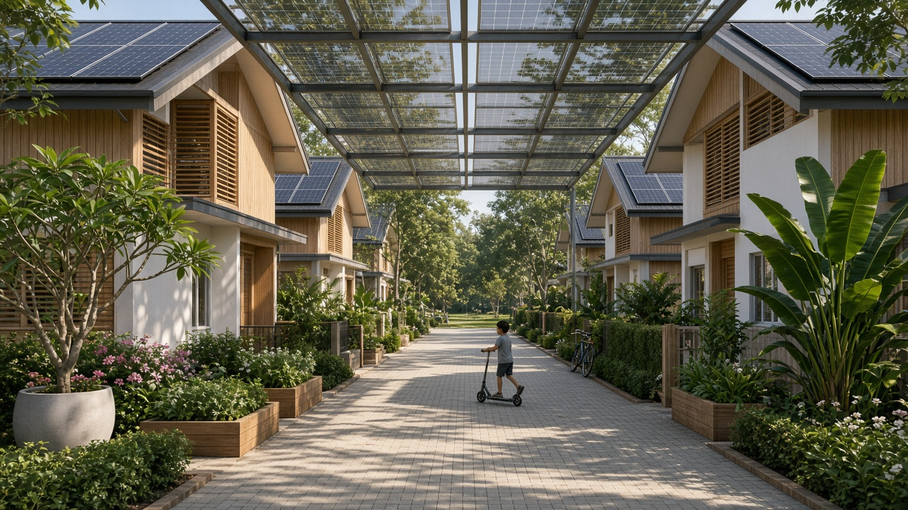

# 07. A cheaper, denser village

*Chapter scope: how far the cost per family can be cut without losing the brief's "acres of floating town" with houses, gardens, public space and solar power. It reuses the unit rates, fee and contingency structure of the reconciled cost table in [08](08-synthesis-and-verdict.md), and the engineering methods of [03](03-site-and-structure.md) and [04](04-systems.md). All costs are 2026 US dollars.*

## Summary

- **Recommended variant: "Village 40".** Forty families (about 160 residents) in terraced timber townhouses of 120 to 160 m² (average 140 m²) on **six 50 × 50 × 6 m concrete caissons** in a 150 × 100 m raft: 15,000 m² gross, **13,300 m² usable** (3.3 acres), plus a marina on the wave attenuator. Each home has a 40 m² private garden or terrace. The public park, plaza, playground and pool total 4,400 m², or **27.5 m² per resident**: about half the reference design's 50 m², but well above UK minimum standards for parks and play space.
- **CAPEX: about US$114m central (US$58m to US$233m), or US$2.9m per family (US$1.4m to US$5.8m).** The risk-adjusted figure is **US$3.8m per family**, against US$6.7m and US$8.8m for the reference design. Roughly half the saving comes from spreading fixed costs over 40 households rather than 25. The other half comes from a third less platform, a cheaper casting yard near the site, a contracted ferry and no helideck.
- **OPEX: about US$5.6m a year, or US$11,600 per family per month gross and US$10,300 net** of a 14-key guest house and other community revenue. The reference costs about US$21,000 gross. Insurance and staff still dominate. Revenue covers only about 10% of running costs.
- **Solar still works, but not from roofs alone.** The smaller roofs carry about 605 kWp against the 880 kWp needed to keep solar at 97% or more. The gap is about 1,600 m² of PV canopies over paths, the plaza and the attenuator walkway. Buying grid power from a nearby city would cost far less (about US$0.19/kWh against roughly US$0.84/kWh fully costed on board), but it would end the solar brief and hand the host a switch.
- **Scale helps up to about 60 families, then flattens.** Per-family CAPEX is US$3.7m at 25 families, US$2.9m at 40, US$2.5m at 60 and US$2.4m at 75. Marine works per family stop falling once every household needs the same deck area.
- **Who can afford it?** Households able to commit about US$3m to US$4m (a net worth of roughly US$8m to US$17m), down from US$20m to US$40m. Professionals with US$1m to US$2m to commit are only reached in a stretch case: 75 families, a host that pays for the breakwater and moorings, a successful pilot, and mortgages on the houses. Even then, monthly costs of about US$13,000 need a household income of around US$500,000.
- **Verdict: Amber.** Village 40 roughly halves the per-family cost and still reads as a floating town, not a marina. It remains a project for the affluent, not the middle class, and the land equivalent is still about four and a half times cheaper.

---

## 1. Problem and method

The reconciled reference project costs **US$166m central (US$75m to US$335m), US$6.7m per family, US$8.8m risk-adjusted**, and about **US$21,000 per family per month** to run ([08](08-synthesis-and-verdict.md)). Chapter 05 flagged two levers it did not cost: a 14,000 m² deck, and "40 smaller homes on 12,000 m²" ([05 §10](05-cost-and-economics.md)). This chapter costs them together, with every other lever we could find, and keeps only the ones that do not break the brief.

**Method.** The reference table in chapter 08 is rebuilt line by line, and reproduces US$166.5m. Only the quantities and rates that the variant changes are altered. Each change is explained in Section 5. The formulas are those of chapters 05 and 06:

| Symbol | Definition |
|---|---|
| Direct cost *D* | Marine works *M* + buildings *B* + landscape and marina *L* + systems including integration *S* |
| Fees *F* | 10 / 12.5 / 15% × (*M* + *B* + *L*) (design, engineering, class, permits) |
| Owner's costs *O* | 3 / 5 / 8% × *D* |
| Pre-contingency base *P* | *D* + *F* + *O* |
| Total CAPEX | *P* × (1 + 25 / 32.5 / 40%) |
| Risk-adjusted outturn | *P* × (0.35 × 1.15 + 0.40 × 1.5 + 0.25 × 3.0) = **1.7525 *P*** (chapter 05's scenario method) |
| OPEX per family per month | Annual OPEX ÷ (families × 12) |

The calculations were done in a short script. Every input appears in the tables below.

---

## 2. The cost levers

| # | Lever | What Village 40 does | Effect (central) | Adopted? |
|---|---|---|---|---|
| 1 | Deck area per household | 800 m² → 333 m² | −US$34.8m CAPEX | Yes |
| 2 | Housing typology and size | 25 × 250 m² detached → 40 × 140 m² terraced | Houses US$16.3m → US$13.8m | Yes |
| 3 | Lighter construction | CLT or timber frame at about 0.5 t/m² of floor | Keeps 40 homes within the 0.6 t/m² deck budget; roughly cost-neutral | Yes |
| 4 | Cheaper hull | Repeat standard caissons cast in a low-cost yard near the site | −US$9.3m (Riau); about zero for Panama | Yes, site-dependent |
| 5 | Shared amenities | Guest house, laundry, workshop, co-working and boats shared | Enables 140 m² homes | Yes |
| 6 | Vessels and ferry | No owned ferry, no helideck; ferry service contracted | −US$3.7m direct CAPEX; +US$0.25m a year | Yes |
| 7 | Clinic | Nurse-led room plus telemedicine; host hospital by fast boat | −US$0.35m direct CAPEX; −1.5 staff | Yes, if a hospital is within ~30 min |
| 8 | Staffing | Contracted marine and utilities operator; trained resident volunteers | 22 → 16.5 full-time equivalents | Yes |
| 9 | Insurance | Same percentage rates as the reference | −US$0.38m a year, from the lower direct cost | Rates unchanged |
| 10 | Grid power and water from the host | Kept solar and desalination | Grid would save ~US$0.38m a year before cable costs | No (noted) |
| 11 | Revenue anchor | 14-key guest house, yacht berths, research lease | +US$0.58m a year net | Yes |
| 12 | Scale | 40 families (25 to 75 tested) | See Section 7 | Yes |

### 2.1 Deck area per household

At US$8,300 per usable m² all-in, deck area is the dominant cost driver. The reference gives each family 800 m². Village 40 gives 333 m², through smaller private gardens, a denser housing layout and a smaller greenhouse. Public open space per person shrinks the least. This lever alone cuts total CAPEX by about a fifth (Section 5).

### 2.2 Housing typology and size

A 140 m² three-bedroom townhouse is about 70% of the median new US single-family home, which was 2,142 ft² (199 m²) in 2025.[^1] The reference's 250 m² is a quarter larger than that median. Terraces save in three ways:

- **Envelope.** A 6 × 11.7 m mid-terrace on two storeys has about 72 m² of external wall, or 0.5 m² per m² of floor. A 250 m² detached house has about 1.2 m² per m². Party walls still need fire separation, but they cost less than façades.
- **Energy.** English mid-terraces are the most energy-efficient house type, because their heat-loss wall area is smaller.[^2] They use 13 to 26 kWh/m² a year less gas than other house types after other factors are controlled for.[^3] In the tropics the same logic applies to solar gain and air-conditioning.
- **Repetition.** Forty near-identical units can be prefabricated.

Smaller homes cost more per m², because kitchens and bathrooms do not shrink. Netting these effects gives a **5% lower rate per m²** than the reference (US$1,710 / 2,470 / 3,610). That is a judgement, not a sourced figure. The larger saving is the floor area itself: 5,600 m² for 40 homes against 6,250 m² for 25.

### 2.3 Lighter construction

Dutch floating homes put a light superstructure on a heavy concrete float. At Maasbommel, each 120 m² home's concrete float weighs 72 t and its timber frame about 22 t,[^4][^5] or about **0.18 t per m² of floor** for the structure. The Dutch industry note on floating construction recommends timber frame or cross-laminated timber (CLT) superstructures to save weight.[^6] Rotterdam's Floating Office is a three-storey CLT building on 15 linked concrete pontoons of 24 × 6 × 3.5 m.[^7] A Swedish comparison found a building with CLT walls weighed 74% of its concrete-walled equivalent, with the walls themselves at 21%.[^8]

**Weight.** Chapter 03 already assumed a light frame (0.6 t/m² of floor, including finishes, services and contents). Village 40 assumes **0.5 t/m²** for CLT townhouses. The value of the lever is that it lets 40 homes fit within the 0.6 t/m² deck budget: masonry homes at about 1.2 t/m² would push the average topside load to 0.83 t/m² (Section 3.3).

**Cost.** The evidence is mixed. Published comparisons range from 26% to 36% dearer for mass timber than for concrete[^9] to 8% cheaper for a six-storey timber apartment block.[^10] This study treats timber as **cost-neutral**. Timber in a humid, salty climate also needs termite and moisture detailing and sprinklers.

### 2.4 Cheaper hulls

Three cheaper hull options were examined:

- **EPS-cored concrete floats.** These are a reinforced concrete shell around an expanded polystyrene core, developed in Canada and used in the Low Countries.[^11][^12] They are unsinkable and need no bilge pumps. One example is a 2,130 ft² Canadian floating home weighing 193 t on a 34 × 52 ft float.[^13] Standard Swedish units of this type (SF1800) are 1.8 m deep, up to 8 × 30 m, have about 1 m of freeboard and carry about 970 kg/m².[^14] Eight of them carry a 33-room floating hotel in Sweden.[^15] They are cheap and catalogue-standard, but have three drawbacks for this project:
  - small modules move more and need many more connectors ([03 §3.2](03-site-and-structure.md));
  - about 1 m of freeboard suits inland water, not a lagoon with a 100-year *Hs* of 1.5 m;
  - a solid core gives up the 13,000 m³ of hull volume per module that chapter 03 uses for tanks and plant.
- **One float per house**, as at Schoonschip (46 households on 30 lots)[^16] and in Dutch practice at about €600/m² of float.[^6] This is the cheapest per m², but it produces a jetty neighbourhood, not a town with a park. It fails the brief.
- **Standard 50 × 50 m caissons cast in a low-cost yard close to the site.** DeltaSync judged 45 to 75 m the best module size.[^17] Construction costs averaged US$943/m² in Jakarta against US$3,104/m² in Singapore in Turner & Townsend's 2025 survey.[^18][^19] Batam, opposite Singapore, has a dense cluster of shipyards,[^20] and the first Maldives floating-city section was built in Sri Lanka.[^21] Cement, steel, class supervision and quality assurance are priced internationally, so not all of the labour saving survives. Village 40 assumes **US$1,600/m² of gross hull instead of US$2,000 central** (US$3,000 instead of US$3,500 high; low unchanged). That is a 20% saving, and it is a judgement.

**Tow.** The yard saving only exists if the yard is near the site. The ocean-tow benchmark in chapter 05 is about US$0.9m to 1.15m per unit per 1,000 miles.[^22] Batam to Panama is roughly 10,000 nautical miles. A heavy-transport ship could carry four or five modules per voyage,[^23] but the transport cost would still absorb the saving. **Village 40's central case therefore assumes a Riau Islands site with a Batam yard.** For Panama, Section 5 shows the cost without the saving, using a local casting basin.

Village 40 keeps hollow caissons, uses EPS fill only in the perimeter cells for damage stability, and repeats one design six times.

### 2.5 Shared rather than private amenities

Cohousing typically trades 15 to 20% smaller private units for common space of about 10% of total floor area.[^24] Village 40 does the same:

- no private guest rooms (a 14-key guest house instead);
- a shared laundry, workshop, gym and co-working room;
- a pool of four shared boats instead of ten private ones.

This is what makes 140 m² homes acceptable to families used to more space.

### 2.6 Fewer vessels and a shared ferry

The reference budget includes an electric fast ferry costing from about US$1.9m[^25] with three crew, a helideck (US$0.8m), a workboat and a rescue boat. Near a city, a scheduled water-taxi contract or a stop on an existing route replaces the owned ferry. The Batam–Singapore benchmark is about SGD 43 one way, including fees, for an hour's international crossing.[^26] Village 40 keeps a fast rescue boat and a workboat (US$0.75m including a charger) and a helicopter winching area. The ferry contract is budgeted at **US$0.25m a year** (estimate), with residents paying their own fares.

### 2.7 Clinic: host hospital plus telemedicine

Cruise guidelines require a physician and a second clinician on call around the clock for 100 or more people at sea,[^27] which is why the reference has three to four clinicians. Within about 10 nautical miles of a hospital, a small-island model is defensible: two nurse-paramedics on rota, a treatment room, a trained resident first-responder team, and a telemedicine contract. Yacht telemedicine services cost from under US$1,000 to about US$8,000 a year per vessel.[^28][^29] A town contract plus a host-clinic retainer is budgeted at US$0.15m a year, including school materials. **This is a real reduction in care**, and births and anything serious go ashore.

### 2.8 Staffing

A contracted marine and utilities operator, with technicians who commute from the city, replaces part of the resident crew. Vendors monitor the plant remotely. Divers and surveys are bought in. Residents form the fire team and run the greenhouse as a co-operative. The result is 13.5 full-time equivalents plus three primary teachers, against about 22 in the reference (Section 4.3). A 10% operator margin is added. Guest-house staff are paid out of hotel revenue.

### 2.9 Insurance

Insurance remains the largest single OPEX line and the least certain. Dutch land homes cost about €1.30 a year per €1,000 of rebuild value to insure.[^30] Dutch houseboats cost more, because they can sink, although concrete-hulled arks are cheaper to insure than steel ones.[^31] Ocean Builders could obtain only third-party liability cover for its SeaPods.[^32] Village 40 keeps chapter 05's rates of **0.75 / 1.25 / 2.0% of direct cost**, plus liability cover. If a classed platform could be insured near ark rates, at say 0.5%, OPEX would fall by about US$0.56m a year (about US$1,150 per family per month). That is upside to be tested in Stage 0, not banked.

### 2.10 Grid power and water from the host city

Panama's regulated medium-voltage tariff is about B/.0.19 per kWh plus a demand charge of about B/.20 per kW-month[^33] (the balboa is at par with the dollar). Village 40's energy plant (PV, canopies, battery, inverters, generators and integration: about US$4.8m) costs about US$0.56m a year, annualised at 7% over 25 years with O&M. That is **about US$0.84 per kWh**, because the PV is oversized for cloudy weeks and 35% of its output is curtailed ([04 §4.3](04-systems.md)).

Buying all power from the grid would cost about US$0.19m a year, saving about **US$0.38m a year (about US$800 per family per month)**. A subsea cable and substation, at an estimated US$1m to US$5m, would absorb between a quarter and all of that saving. Grid supply would also break the solar brief and give the host an off-switch.

**Recommendation:** keep solar. Consider a short shore cable only as a replacement for the HVO emergency generators, and only where grid power is within a couple of kilometres. Piped municipal water raises the same issues. Desalination stays.

### 2.11 Revenue anchor

The revenue anchor is a **14-key guest house** with a café-restaurant, 12 visiting-yacht berths, a leased research station and day visitors. The margin assumptions are conservative:

- **Hotel.** HotStats' 2025 European average gross operating profit (GOP) margin was 35.7%,[^34] with wellness resorts at 26%.[^35] This chapter uses 35%, less a 4% reserve for furniture and fittings. That is below chapter 05's implied margin of about 54%.
- **Room rate.** US$220 at 60% occupancy, between Bocas del Toro's average and its top decile.[^36]
- **Yacht berths.** Linton Bay in Panama charges US$0.75 per foot per night for transient berths.[^37]
- **Co-working.** Panama City co-working desks rent for US$229 to US$289 a month.[^38] Residents' own use is a transfer, not income.

| Line | Assumption | Gross (US$k a year) | Net (US$k a year) |
|---|---|---|---|
| Guest house, 14 keys | Rooms US$675k; food and drink 35% of rooms | 911 | 282 (GOP 35%, less 4% reserve) |
| Visiting-yacht berths, 12 | ~US$35 per night on average, 50% occupancy | 77 | 46 |
| Day visitors and events | 6,000 × US$40 | 240 | 120 |
| Research station lease | 2 labs plus a berth | 150 | 120 |
| Co-working, visitors only | | 30 | 15 |
| **Total (central)** | | **1,407** | **583** (low-cost case 793, high-cost case 319) |

The guest house costs about US$3.8m all-in and earns about 7% on that. It is worth having, but all five lines together cut the levy by only about US$1,200 per family per month.

### 2.12 Scale

Spreading the school, plant, governance, insurance minimums and staff over more families is the most powerful lever after deck area. It stops working once marine works dominate. Section 7 sets out the scale curve.

---

## 3. The recommended variant: Village 40

*AI-generated impression, not a design drawing.* A car-free interior lane of terraced townhouses, the typology Village 40 uses, under the PV canopies needed to keep the village at least 97% solar. Planting is in containers to respect the deck-load budget.

### 3.1 Definition

| Parameter | Reference ([08](08-synthesis-and-verdict.md)) | **Village 40** |
|---|---|---|
| Families / residents | 25 / ~100 | **40 / ~160** (about 206 on board with duty staff and guests) |
| Homes | Detached, 250 m² of floor on a 150 m² footprint, 100 m² garden | **Terraced townhouses, 2 to 3 storeys, 120 / 140 / 160 m² (average 140), 70 m² footprint, 40 m² garden or terrace** |
| Superstructure | Light timber or steel, 0.6 t/m² of floor | CLT or timber frame, 0.5 t/m² of floor |
| Platform | 9 caissons, 50 × 50 × 6 m, 3 × 3; 22,500 m² gross | **6 caissons, 50 × 50 × 6 m, 3 × 2 (150 × 100 m); 15,000 m² gross, 13,300 m² usable** |
| Deck per family | 800 m² | **333 m²** |
| Wave attenuator / moorings / joints | ~500 m / 12 / 12 | ~420 m / 10 / 7 |
| Communal floor | ~2,000 m² | 1,600 m² plus a 700 m² guest house (14 keys) |
| Site | Sheltered lagoon | Sheltered lagoon within ~10 nautical miles of a city with a hospital and secondary schools; central case Riau Islands with a Batam yard |

### 3.2 Land use and outdoor space

| Use | Reference (m²) | Village 40 (m²) | Notes |
|---|---|---|---|
| Houses, footprint | 3,750 | 2,800 | 40 × 70 m² |
| Private gardens or terraces | 2,500 | 1,600 | 40 × 40 m² |
| Communal buildings | 1,500 | 1,300 | Includes the guest house; mostly two storeys |
| Utilities and plant on deck | 800 | 500 | Tanks, desalination and wastewater plant in hull voids; batteries in edge enclosures |
| Food production | 2,000 | 900 | Hydroponic greenhouse |
| Public open space | 5,000 | 4,400 | Park, plaza, playground, court, 200 m² pool |
| Circulation | 2,500 | 1,800 | |
| Marina and perimeter | 2,000 | (1,200, outside) | On the attenuator pontoons, as chapter 03 recommends |
| **Total usable** | **~20,000** | **13,300** (+1,200 marina) | 3.3 acres usable; ~4.7 acres including the attenuator ring |

| Outdoor space per resident | Reference | Village 40 | Benchmark |
|---|---|---|---|
| Public open space | 50 m² | **27.5 m²** (21 m² counting staff and guests) | UK Fields in Trust minimums: parks 8, amenity green space 6, play 5.5, total 19.5 m²;[^39] US median parkland 10 acres per 1,000 residents ≈ 40 m²[^40] |
| All outdoor deck (gardens, food, open space) | 95 m² | **43 m²** | Fields in Trust overall minimum 53.5 m², including 18 m² of natural green space and 16 m² of sports pitches[^39] |
| Private garden per home | 100 m² | 40 m² | |

Village 40's public space is about 1.4 times the UK minimum for parks, amenity space and play, and about two-thirds of the median US parkland provision. The lagoon itself stands in for the "natural" space a land town would need. At 30 homes per hectare, Village 40 has the density of a suburban terrace street. The reference, at 12.5, is a low-density estate.

### 3.3 Module layout, deck load and draught (chapter 03 method)

A 3 × 2 raft keeps the large-module motion benefits. Compared with a 3 × 3 raft it has 7 internal joints instead of 12 and a 500 m perimeter instead of 600 m. The long side faces the dominant fetch.

| Topside item | Basis | Tonnes |
|---|---|---|
| 40 townhouses | 5,600 m² of floor × 0.5 t/m² | 2,800 |
| Communal and guest house | 2,300 m² × 0.6 t/m² | 1,380 |
| Utilities, batteries, tanks | Plant plus ~300 m³ of water | 800 |
| Food production | 900 m² × 0.5 | 450 |
| Private gardens or terraces | 1,600 m² × 0.5 (containers and paving) | 800 |
| Public open space | 4,400 m² × 0.325 (half planted, half paved) | 1,430 |
| Circulation | 1,800 m² × 0.15 | 270 |
| Pool, edge fittings, PV canopies | | 560 |
| **Total** | | **8,490 t = 0.57 t/m² over 15,000 m²** (budget 0.6) |

| Per module | Reference | Village 40 |
|---|---|---|
| Hull (2.2 t/m²) + outfitting | 5,750 | 5,750 |
| Topsides | 1,336 | 1,415 |
| Variable load (0.15 t/m²) | 375 | 375 |
| **Displacement Δ** | **7,461 t** | **7,540 t** |
| Draught *T* = Δ / (1.025 × 2,500) | 2.91 m | **2.94 m** |
| Freeboard (6.0 − *T*) | 3.1 m | **3.06 m** |

The variant passes the budget with a 5% margin. With houses at chapter 03's 0.6 t/m², the load is 0.60 t/m² and the draught 2.98 m, which is still acceptable. With masonry houses at about 1.2 t/m², the load would be 0.83 t/m², the draught 3.20 m and the freeboard 2.8 m. Chapter 03's rule would then require 6.5 m hulls. **Light construction is a precondition for the density, not a cost saving.**

---

## 4. Systems re-run

### 4.1 Energy

Per home: air-conditioning 14 × (105 / 150 m² conditioned) × 0.9 (terrace factor) = **8.8 kWh/day**; cooking, hot water and laundry 7.5 (they scale with people, not floor area); refrigeration, lighting and IT 4.0. That is **20.3 kWh/day**, between Singapore's 2024 averages of about 17 for condominiums and about 40 for landed houses.[^41]

| Load (kWh/day) | Reference | Village 40 | Change |
|---|---|---|---|
| Houses | 650 (25 × 26) | 813 (40 × 20.3) | |
| Communal | 330 | 404 | School 60, nurse clinic 15, hall, café and co-working 140, guest house 146, duty staff 28, gym 15 |
| Desalination | 170 | 205 | 45.5 m³/day × 4.5 kWh/m³ |
| Water pumps, wastewater, cold store | 117 | 122 | |
| Greenhouse, workshop | 75 | 45 | Smaller greenhouse |
| Boat charging | 150 | 80 | Ferry charges ashore |
| Lighting, comms, safety, pool, auxiliaries | 179 | 161 | |
| **Total** | **1,671** | **1,830** (1,370 to 2,470) | +10% for 60% more families |

Scaling chapter 04's hourly simulation in proportion (800 kWp and 2.5 MWh for 1,671 kWh/day) gives **880 kWp and 2.75 MWh**. That holds the generator share at about 0.15% in a normal year. Assuming the same load shape is an approximation.

| PV surface (chapter 04 method, 185 Wp per usable m²) | Gross (m²) | Usable | Usable (m²) | kWp |
|---|---|---|---|---|
| House roofs | 2,800 | 70% | 1,960 | 363 |
| Communal roofs | 1,300 | 70% | 910 | 168 |
| Utility roofs | 500 | 80% | 400 | 74 |
| **Roofs subtotal** | | | **3,270** | **605** |
| Canopies needed: paths, plaza and playground shade, attenuator walkway | ~1,630 | 90% | 1,465 | 271 |
| **Total** | | | | **~880** |

**Do roofs alone still cover demand? No.** They provide 69% of the required capacity. Chapter 04 found that 600 kWp with 1 MWh, at a 10% lower load, already needed the generator for 4.2% of annual energy. Roofs alone would therefore breach the "≥ 97% solar" standard.

About 1,900 m² of canopy is available (about 315 kWp), so the central case fits with little headroom. The high-load case (2,470 kWh/day) needs about 1,180 kWp. That means either about 1,500 m² of floating PV inside the attenuator, subject to the seagrass and coral shading assessment in chapter 04, or tiered air-conditioning tariffs. Energy CAPEX rises from US$3.4m to US$4.1m before integration.

### 4.2 Water

Design population is 200 at 130 L/day, or 26.0 m³. Adding communal use (4.0), hydroponics (0.9), gardens (2.0), the pool (1.2) and workshop use (1.0) gives 35.1 m³. With 8% losses the average is **37.9 m³/day**, and the design flow (×1.2) is **45.5 m³/day**. Chapter 04's three 25 m³/day trains still give 50 m³/day firm with one out of service, so the desalination plant is unchanged. Potable storage rises to 300 m³ (eight days at average demand), and the wastewater plant becomes 2 × 25 m³/day. The 4,600 m² of roofs yield about 5,300 m³ of rain a year in Panama (1,917 mm × 0.8 × 0.75), a useful non-potable supplement.

### 4.3 Staff

| Role (full-time equivalents) | Reference ([04 §12](04-systems.md), [02](02-governance-and-society.md)) | Village 40 | How |
|---|---|---|---|
| Chief engineer / site manager | 1 | 1 | Operator's site manager |
| Electrical and power | 2 | 2 | Vendor remote monitoring |
| Water and wastewater | 2 | 1 | Containerised plant, vendor service contract |
| Marine and hull | 2 | 1 | Divers and surveys contracted from the city |
| Air-conditioning and buildings | 2 | 2 | |
| IT, comms, radio | 1 | 0.5 | Shared with operator; microwave link to shore |
| Boat crew | 3 | 2 | Rescue boat and workboat only |
| Clinicians | 3 to 4 | 2 | Nurse-paramedics plus telemedicine |
| Safety officer | 1 | 1 | Plus a resident volunteer fire team |
| Stores, logistics, food | 2 | 1 | Greenhouse run as a residents' co-operative |
| Teachers | 3 to 4 | 3 | Primary on board; secondary ashore by ferry |
| **Total** | **~22** | **16.5** | Plus about 8 guest-house staff paid from revenue |

---

## 5. CAPEX

| US$m, 2026 | Low | Central | High | Reference central |
|---|---|---|---|---|
| Marine works: caissons, connectors, tow and installation, attenuator, moorings | 19.4 | 39.5 | 81.4 | 66.0 |
| Houses (5,600 m²) and communal including guest house (2,300 m²) | 14.2 | 20.7 | 30.6 | 22.3 |
| Landscape, greenhouse shell, public realm (8,700 m²), marina pontoons (1,200 m²) | 1.9 | 3.8 | 6.8 | 5.6 |
| Systems including integration (+12 / 18 / 25%) | 5.8 | 10.5 | 18.9 | 14.6 |
| **Direct cost** | **41.3** | **74.5** | **137.6** | **108.5** |
| Design, engineering, class, permits (10 / 12.5 / 15% of non-systems) | 3.6 | 8.0 | 17.8 | 11.7 |
| Owner's costs, construction insurance, interest (3 / 5 / 8%) | 1.2 | 3.7 | 11.0 | 5.4 |
| *Pre-contingency base* | *46.1* | *86.3* | *166.4* | *125.6* |
| Contingency, first-of-a-kind (25 / 32.5 / 40%) | 11.5 | 28.0 | 66.6 | 40.8 |
| **Total CAPEX** | **58** | **114** | **233** | **166** |
| **Per family (40)** | **US$1.44m** | **US$2.86m** | **US$5.82m** | US$6.66m (25) |
| Per m² of usable deck (13,300) | US$4,300 | US$8,600 | US$17,500 | US$8,300 |
| **Risk-adjusted (1.7525 × base)** | | **US$151m; US$3.78m per family** | | US$220m; US$8.81m |

**What changed, line by line** (everything else uses chapter 08's rates):

- **Marine works.**
  - Hull: 15,000 m² gross × US$900 / 1,600 / 3,000 = 13.5 / 24.0 / 45.0 (yard lever, Section 2.4).
  - Connectors: 7 joints instead of 12, so chapter 03's 1 / 3 / 8 × 7/12.
  - Tow and installation: 6 modules instead of 9, so 3 / 8 / 20 × 6/9. This is conservative for a short tow from Batam.
  - Attenuator: 420 m × US$4,000 / 10,000 / 20,000 per metre.
  - Moorings: 10 points instead of 12.
- **Buildings.** Houses: 5,600 m² × US$1,710 / 2,470 / 3,610 (Section 2.2). Communal: 2,300 m² at chapter 05's US$2,000 / 3,000 / 4,500.
- **Landscape and marina.** Landscaped deck 8,700 m² (gardens, food, open space and circulation) at US$150 / 300 / 500, plus 1,200 m² of marina at US$500 / 1,000 / 2,000.
- **Systems.** Chapter 04's itemised table, with these rows changed (central, US$k):
  - PV 880 kWp: 1,577 (was 1,440); new canopy structures for 1,630 m²: 407;
  - battery 2.75 MWh: 1,095 (1,000); inverters: 766 (700);
  - storage +50 m³: 508 (460); wastewater 2 × 25 m³/day: 360 (300); greenhouse 900 m²: 225 (500);
  - vessels (rescue boat, workboat, charger): 750 (3,200); medevac winching area only: 100 (800);
  - fire, flood and structural monitoring scaled by 0.8 for the smaller platform: 1,760 (2,200);
  - nurse-led clinic: 200 (500); spares at 3.5%.
  - Raw total US$8.9m (was US$12.4m).

**Where the saving comes from** (total CAPEX, central, including fees and contingency):

| Step | Total (US$m) | Change |
|---|---|---|
| Reference | 166.5 | |
| Six modules, 13,300 m² usable; shorter attenuator; fewer joints and moorings; smaller landscape and marina | 131.7 | −34.8 |
| Hull cast in a low-cost yard near the site | 122.3 | −9.3 |
| 40 terraced homes and 2,300 m² communal including guest house | 120.0 | −2.4 |
| Systems: contracted ferry, no helideck, nurse clinic, more PV | 114.3 | −5.7 |
| **Per family** | **US$6.66m → US$2.86m** | **−57%** |

Housing changes little in total, because 40 homes of 140 m² have only 10% less floor than 25 of 250 m². The per-family fall is roughly half from **spreading** and half from **cutting**. Dividing the unchanged reference by 40 gives US$4.16m. Cutting costs but keeping 25 families gives US$4.57m.

**Panama sensitivity.** Without the yard saving (local casting basin at chapter 08 rates), the total is US$124m central, or **US$3.09m per family (US$4.09m risk-adjusted)**. This is the main way the variant depends on the site.

---

## 6. OPEX and the monthly bill

The reference OPEX was rebuilt from chapter 08's capital figures with chapter 05's percentages and chapter 04's systems and staff tables. It comes to US$6.37m, against US$6.5m in chapter 08. The variant changes only the inputs.

| US$m a year | Low | Central | High | Reference (rebuilt) | Basis |
|---|---|---|---|---|---|
| Marine maintenance | 0.17 | 0.51 | 1.70 | 0.87 | 1 / 1.5 / 2.5% of marine works excluding tow |
| Buildings and landscape | 0.16 | 0.37 | 0.75 | 0.42 | 1 / 1.5 / 2% |
| Systems O&M, including battery fund | 0.23 | 0.50 | 0.91 | 0.63 | Chapter 04 rows 1 to 16, rescaled |
| Insurance | 0.43 | 1.18 | 3.25 | 1.56 | 0.75 / 1.25 / 2.0% of direct cost + liability (0.12 / 0.25 / 0.50) |
| Staff | 0.94 | 1.59 | 2.38 | 1.69 | 11.5 / 13.5 / 16 FTE × US$65k / 90k / 110k × 1.10 operator margin, plus 2 / 3 / 4 teachers |
| Supply logistics and waste | 0.10 | 0.25 | 0.60 | 0.25 | Weekly supply run |
| Ferry service contract | 0.10 | 0.25 | 0.60 | (own ferry) | Estimate |
| Governance, legal, audit, class | 0.15 | 0.35 | 0.80 | 0.35 | Does not shrink |
| Host concession fee | 0.07 | 0.28 | 0.70 | 0.40 | ~28,000 m² of water instead of ~40,000 |
| Consumables | 0.06 | 0.12 | 0.24 | 0.10 | Scaled by people |
| Education and health (non-staff) | 0.08 | 0.15 | 0.30 | 0.10 | Telemedicine, host-clinic retainer, school materials |
| **Total OPEX** | **2.5** | **5.55** | **12.2** | **6.37** | |
| **Per family per month, gross** | **US$5,200** | **US$11,600** | **US$25,500** | US$21,200 | |
| Less net community revenue (Section 2.11) | −0.79 | −0.58 | −0.32 | −0.7 | |
| **Per family per month, net** | **US$3,600** | **US$10,300** | **US$24,800** | ~US$19,000 | |

Total running costs fall only 13%, but the bill per family falls 45%. Insurance (21%) and staff (29%) are still half of OPEX. Staff numbers fall a quarter, while staff cost per family falls from about US$68,000 to US$40,000 a year. Energy remains trivial.

---

## 7. Comparison and scale

### 7.1 Against the reference and land alternatives

| Option, per family | Up-front cost | Running cost per month | 20-year undiscounted | What you get |
|---|---|---|---|---|
| Reference seastead ([08](08-synthesis-and-verdict.md)) | US$6.7m (US$8.8m risk-adjusted) | ~US$19,000 net | ~US$11.2m (US$13.4m) | 250 m² detached house, 100 m² garden, 50 m² of public space per resident, chartered autonomy |
| **Village 40** | **US$2.9m (US$3.8m)** | **~US$10,300 net** | **~US$5.3m (US$6.3m)** | 140 m² terrace, 40 m² garden, 27.5 m² of public space per resident, the same charter |
| Village 40 built on land, Panama (chapter 05 method)[^42] | ~US$0.63m | ~US$1,000 to 3,000 (estimate) | ~US$0.9m to 1.4m | Same homes and space; host law in full |
| Gated community, Panama ([05 §8](05-cost-and-economics.md)) | US$0.4m to 0.7m (mid); US$1.2m to 1.5m (premium coastal), for 250 m² | US$1,000 to 3,000 | ~US$0.7m to 2.2m | Stable residency; no special zone |
| Village, Portugal ([05 §8](05-cost-and-economics.md)) | ~US$1.15m (250 m²) | Low | ~US$1.3m | EU legal certainty |
| Próspera, Honduras, 140 m² equivalent ([05 §8](05-cost-and-economics.md)) | ~US$0.47m to 0.54m | Not verified | n/a | Special zone whose legal basis has been struck down |
| *MS The World*, entry residence ([05 §8](05-cost-and-economics.md)) | From US$3.5m | US$23,000 to 29,000 | ~US$10m | Too small for a family; no self-government |

The land version uses chapter 05's method: houses at US$1,650/m², communal at US$1,500/m², 1.33 ha of land at US$130/m², US$5m of infrastructure, plus 30%. That gives US$25m in total. Village 40 costs **about 4.5 times its land equivalent**, down from about six times for the reference. Over 20 years a Village 40 family spends about half as much as a reference family, and about half the 20-year cost of the cheapest *MS The World* residence.

### 7.2 Scale curve (Village 40 typology)

Assumptions:

- Usable deck = 3,300 m² fixed + 250 m² per family, rounded up to whole modules. At 60 families this means accepting a 3% squeeze.
- Attenuator and moorings scale with √area. Energy scales with demand (600 + 30.7 kWh/day per family). Water and wastewater scale with people^0.8.
- Staff are 14.5 / 16.5 / 19 / 21 FTE including teachers.
- The guest house stays at 14 keys. Fee and contingency rates are unchanged.

| Families | Modules (usable m²) | Deck per family | Total CAPEX, central | CAPEX per family (low / central / high) | Risk-adjusted per family | OPEX per family per month, gross / net |
|---|---|---|---|---|---|---|
| 25 | 5 (11,100) | 444 m² | US$92m | US$1.84m / **3.69m** / 7.60m | US$4.88m | US$15,800 / 13,800 |
| **40** | **6 (13,300)** | **333 m²** | **US$114m** | **US$1.44m / 2.86m / 5.82m** | **US$3.78m** | **US$11,600 / 10,300** |
| 60 | 8 (17,800) | 296 m² | US$150m | US$1.27m / **2.51m** / 5.09m | US$3.32m | US$9,400 / 8,600 |
| 75 | 10 (22,200) | 296 m² | US$182m | US$1.23m / **2.43m** / 4.93m | US$3.21m | US$8,600 / 8,000 |
| *Reference, 25* | *9 (20,000)* | *800 m²* | *US$166m* | *US$2.99m / 6.66m / 13.39m* | *US$8.81m* | *US$21,200 / ~19,000* |

Going from 25 to 40 families saves US$0.8m per family. Going from 60 to 75 saves only US$0.1m. Each extra family brings its own 250 m² of deck at about US$5,000 per m² all-in, so the marine cost per family stops falling. For running costs the curve keeps improving, because staff and governance are largely fixed.

**Stretch case.** Take Village 75 after a successful pilot, and assume:

- the host funds the attenuator and moorings as coastal infrastructure (about US$10.8m);
- contingency falls to the 25% that chapter 05 uses for a second-of-a-kind build;
- insurance falls to 0.75%.

Village 75 then costs about **US$2.1m per family (US$2.9m risk-adjusted)** and about **US$6,800 a month net**. That is the floor of what this study can defend.

---

## 8. What is lost and what is gained

**Lost:**

- **Privacy and garden size.** Shared walls, 40 m² gardens overlooked by neighbours, and 60% less private outdoor space. Children's play moves from the garden to the park.
- **Prestige.** A townhouse in a waterside terrace, not a villa. For some founders this is the product.
- **Autonomy and resilience.** The village relies on the host city's ferry operator, hospital, secondary schools and contractors. It no longer has its own fast ferry or helideck, or a doctor on call around the clock. The host has more levers, which matters given that host reversal is risk 1 in chapter 08.
- **Strangers on deck.** The guest house, researchers and day visitors bring 30 to 40 outsiders a day into a small polity. That is good for revenue and the local relationship, and harder for security and governance.
- **Generosity of space.** Public space per resident falls from about 1.2 times US median parkland to about two-thirds of it.

**Gained:**

- **Cost.** About **57% less capital and 45% less running cost per family**.
- **A stronger community.** Forty households instead of 25 means a viable primary school (about 30 children on board), more people to share volunteer roles, and less exposure to attrition. Each departing family raises the others' levy by about 2.6% (1/39) instead of 4.2% (1/24).
- **A product that can be financed.** Standard townhouses that a lender can value, and a guest house that can carry its own debt (Section 9).
- **A better base for Phase 2.** The same module, house type and operator contract can be repeated.

**Does it still meet the brief?** Mostly, yes.

- **Acres of floating town:** 3.3 acres usable, about 4.7 including the attenuator promenade. That is fewer acres, but still a town with a park, plaza and pool rather than a jetty estate.
- **Plenty of outdoor space:** 27.5 m² of public space per resident exceeds the UK minimum for parks, amenity green space and play by about 40%, and every home has a garden. That is adequate rather than plenty.
- **Fully solar:** yes at 97% or more, but only with canopies, and the high-load case needs floating PV or tariff discipline.

---

## 9. Financing: who could now afford it?

**All-equity (central).** Each family commits US$2.9m plus about US$0.9m of standby capital (the gap to the risk-adjusted figure), so about **US$3.8m in total**, and pays about US$10,300 a month. Chapter 08 implied a net worth of 2.2 to 4.4 times the commitment. On that basis Village 40 founders need a **net worth of roughly US$8m to US$17m**, against US$20m to US$40m for the reference.

UBS counts about 52 million adults worldwide with US$1m to US$5m and almost 60 million US-dollar millionaires in total.[^43] That implies roughly 8 million above US$5m, a subtraction by this author. Village 40's market is the upper part of that group: several times larger than the reference's market, but not the broad membership.

**Geared (after the pilot).** The project is split into separately financed pieces:

| Piece | Amount per family (all-in) | Financed by | Monthly cost per family |
|---|---|---|---|
| House | US$0.54m | 70% host-country mortgage (US$0.38m) at 8.5% over 20 years | ~US$3,300 |
| Energy, water and waste plant | US$0.37m | Utility concession owned by an infrastructure investor and recovered through tariffs (8%, 20 years) | ~US$3,100 |
| Guest house | US$0.10m | Hotel investor or debt against its cash flow | (none) |
| Platform and common realm | US$1.86m | Family equity (plus standby) | (none) |
| **Total** | **US$2.86m** | **Equity about US$2.0m** | **~US$16,700 including net OPEX** |

**Are mortgages plausible?** Panamanian banks lend to non-residents:

- Caja de Ahorros lends up to 70% of value over up to 20 years.[^44]
- Another lender quotes 7.5% plus the 1% FECI surcharge for non-residents buying new homes.[^45]

Dutch lenders already finance floating homes:

- Triodos lends up to 90% on ship-registered water homes with concrete hulls.[^46]
- Since January 2026 the national mortgage guarantee covers floating homes, but only where a government body grants a transferable berth.[^47]

The common thread is a public-law title. A Village 40 home becomes mortgageable once:

- the host registers each townhouse plot as a strata lease within the concession, in its public property register;
- the platform is classed and insured;
- there is a resale record.

**None of that exists before the pilot.** Marine (yacht-style) loans at 6.5 to 12% ([05 §5](05-cost-and-economics.md)) could finance a home only if it were a movable vessel, which a townhouse on a shared raft is not.

**The US$1m to US$2m professional.** Combining the stretch case (US$2.1m per family) with the geared structure gives an equity requirement of about **US$1.3m**. The monthly cost would be about US$13,000 (US$6,800 net OPEX plus mortgage and utility tariff). At the usual 30% housing-cost ratio, that needs a household income of about US$530,000. So a high-earning couple or an early retiree with US$1.5m to commit can get there. A typical upper-middle-class family with US$1m to US$2m of wealth and a normal professional salary cannot.

---

## 10. Effect on the staged plan

The pilot keeps its cost but changes its nature. One module carrying **six standard townhouses**, a utility core, 150 m of attenuator, four moorings and a rescue boat costs about **US$12m direct and US$18m all-in**, within chapter 08's US$15m to US$25m. The reference pilot housed only 2 to 3 homes. Six founding families paying about US$3m each could fund it outright, so the pilot becomes a saleable first phase rather than a research cost.

Three gates should be added to chapter 08's list:

- a written mortgage offer on a standard townhouse;
- an insurer quote at or below 1.25% of direct cost;
- a signed ferry and hospital-access agreement with the host city.

---

> ### Verdict: **AMBER**, feasible with significant caveats
>
> Village 40 is a credible floating town: 40 families on 3.3 acres of six concrete caissons, with gardens, a park, a guest house and ≥ 97% solar power. It cuts per-family CAPEX from **US$6.7m to US$2.9m** (US$1.4m to US$5.8m; **US$3.8m risk-adjusted**) and the monthly bill from about **US$21,000 to US$11,600 gross, or US$10,300 net**. It widens the market from founders worth US$20m to US$40m to households worth about US$8m to US$17m, and with mortgages, a host-funded breakwater and 75 families it comes within reach of households with about US$1.5m to commit and a high income. It does not make seasteading a middle-class option. It is still about 4.5 times the cost of the same village on land.
>
> **Top risks**
> 1. **Insurance.** At 21% of OPEX, insurance is still the biggest unknown. Ark-like rates would cut the levy by about US$1,150 a month; no quote exists.
> 2. **Deeper host dependence.** The ferry, hospital, schools, contractors and possibly grid power all come from the host city. That buys cost savings with exactly the leverage chapter 08 ranks as the top risk.
> 3. **First-of-a-kind overrun.** The 1.75 risk multiplier still adds about US$0.9m per family. Denser buildings do not make the marine works less novel.
> 4. **Site-dependent hull saving.** The cheap-yard saving (US$9m) exists only beside a low-cost yard such as Batam. In Panama the cost rises to US$3.1m per family.
> 5. **Density and governance friction.** Terraces, shared amenities and hotel guests make privacy, noise and access the everyday political issues. The charter must handle them from day one.

---

## References

[^1]: US Census Bureau, "Highlights of 2025 Characteristics of New Housing" (median completed single-family home 2,142 ft²). https://www.census.gov/construction/chars/highlights.html (accessed 4 Nov 2026).
[^2]: Ministry of Housing, Communities and Local Government, *English Housing Survey: Energy efficiency, 2018-19* (mid-terraces most energy-efficient house type owing to smaller heat-loss wall area). https://assets.publishing.service.gov.uk/media/5f0474b8e90e0712ca89e3b4/Energy_Report.pdf (accessed 4 Nov 2026).
[^3]: Department for Business, Energy and Industrial Strategy, *National Energy Efficiency Data-Framework 2019, Annex D: Determinants of household gas use* (27 June 2019). https://assets.publishing.service.gov.uk/government/uploads/system/uploads/attachment_data/file/812418/Annex_D_Determinants_of_household_gas_use.pdf (accessed 4 Nov 2026).
[^4]: Urban Green-Blue Grids, "Amphibious homes, Maasbommel, The Netherlands" (72 t concrete float, ~22 t timber frame). https://urbangreenbluegrids.com/projects/amphibious-homes-maasbommel-the-netherlands/ (accessed 4 Nov 2026).
[^5]: KiesKlimaat, "Maasbommel amfibische woningen (2005): bouwkosten circa 250.000–300.000 euro per woning van 120 m²". https://kiesklimaat.nl/datapoint/1501 (accessed 4 Nov 2026).
[^6]: KBF, "Memo: Drijvend en amfibisch bouwen" (Dec 2025; concrete float ~€600/m² citing Deltares; EPS-filled caissons; timber frame and CLT superstructures to limit weight). https://www.kbf.nl/assets/uploads/2025/12/KBF-Memo-drijvend-amfibisch-bouwen-260129-druk.pdf (accessed 4 Nov 2026).
[^7]: FOR Building, "Floating Office Rotterdam" (15 concrete pontoons of 6 × 24 × 3.5 m forming a 24 × 90 m float; three-storey CLT structure). https://forbuilding.nl/floating-office-rotterdam/ (accessed 4 Nov 2026).
[^8]: "Comparing performance of cross-laminated timber and reinforced concrete walls", *International Journal of Applied Mechanics and Engineering* 26(3), 2021. https://doi.org/10.2478/ijame-2021-0033 (accessed 4 Nov 2026).
[^9]: "Comparative assessment of the economic feasibility of mass timber buildings", *Business, Management and Economics Engineering* (2025; literature review of cost premiums from 3% to 36%). https://doi.org/10.3846/bm.2025.1466 (accessed 4 Nov 2026).
[^10]: MBM for Australian Sustainable Hardwoods, *Social Housing: cost comparison of traditional versus timber construction, 6-storey apartment building* (Aug 2024). https://ash.com.au/wp-content/uploads/2024/08/ASH-Affordable-Housing-Report-MBM-240828.pdf (accessed 4 Nov 2026).
[^11]: NAV (Flemish Architects' Association), "Waterrobuust bouwen: drijvend gebouw" (concrete tubs, steel hulls and Canadian-origin EPS-core concrete floats). https://www.nav.be/kennisnet/waterrobuust-bouwen-drijvend-gebouw (accessed 4 Nov 2026).
[^12]: International Marine Floatation Systems, "Floating structure technology" (reinforced concrete shell with expanded polystyrene core). https://floatingstructures.com/technology/ (accessed 4 Nov 2026).
[^13]: International Marine Floatation Systems, "Peters" floating home, Ladner, B.C. (2,130 ft², 34 × 52 ft float, 193 t). https://floatingstructures.com/projects/floating-homes/peters/ (accessed 4 Nov 2026).
[^14]: SF Marina, "Helbetongbrygga SF1800" datasheet (1.8 m deep, 4 to 8 m wide, ~1 m freeboard, ~970 kg/m² capacity, EPS core). https://sfpontona.se/wp-content/uploads/2026/02/sf1800.pdf (accessed 4 Nov 2026).
[^15]: SF Marina, "Swedish hotel floats on SF Marina pontoons" (Slottsholmen, eight SF1880-22 m pontoons, 22 × 63 m). https://sfmarina.com/swedish-hotel-floats-on-sf-marina-pontoons/ (accessed 4 Nov 2026).
[^16]: Stedenbouw, "Concrete floats form the foundation of project Schoonschip". https://stedenbouw.nl/en/residential-and-commercial-construction/clean-ship-concrete-floats-form-the-foundation-of-project-clean-ship/ (accessed 4 Nov 2026).
[^17]: DeltaSync for The Seasteading Institute, "Seasteading Implementation Plan: Final Report" (concept design and cost estimate), Dec 2013. https://www.seasteading.org/wp-content/uploads/2015/12/DeltaSync-Final-Concept-Report.pdf (accessed 4 Nov 2026).
[^18]: Turner & Townsend, *Global Construction Market Intelligence 2025*, "Asia". https://publications.turnerandtownsend.com/global-construction-market-intelligence-2025/asia (accessed 4 Nov 2026).
[^19]: Kompas.com, "Biaya Konstruksi di Jakarta Tempati Urutan ke-15 Asia" (9 Jul 2025; GCMI 2025 city ranking: Jakarta US$943/m², Singapore US$3,104/m²). https://www.kompas.com/properti/read/2025/07/09/113524421/biaya-konstruksi-di-jakarta-tempati-urutan-ke-15-asia (accessed 4 Nov 2026).
[^20]: BP Batam, "Marine and Shipyard Industries in Batam" (2021 edition). https://bpbatam.go.id/wp-content/uploads/2022/07/SHIPYARD-2021.pdf (accessed 4 Nov 2026).
[^21]: *Le Figaro* (English), "In the Maldives, Floating Cities Designed To Survive the Onslaught of the Sea", 12 Nov 2025. https://www.lefigaro.fr/en/world/in-the-maldives-floating-cities-designed-to-survive-the-onslaught-of-the-sea-20251112 (accessed 4 Nov 2026).
[^22]: J. G. McConville (Compass International), "FPSO Cost Benchmarks" (2021 data). https://www.linkedin.com/pulse/fpso-cost-benchmarks-john-g-mcconville-ccp (accessed 4 Nov 2026).
[^23]: Boskalis, "Transport and installation Moho Nord FPU" (Dockwise Vanguard). https://boskalis.com/about-us/projects/transport-and-installation-moho-nord-fpu (accessed 4 Nov 2026).
[^24]: "Sharing Is Saving? Building Costs Simulation of Collaborative and Mainstream Housing Designs", *Buildings* 13(3):821, 2023. https://www.mdpi.com/2075-5309/13/3/821 (accessed 4 Nov 2026).
[^25]: electrive.com, "Candela kicks off series production of the P-12 water taxi" (17 Nov 2023; €1.7m). https://www.electrive.com/2023/11/17/candela-kicks-off-series-production-of-the-p-12-water-taxi/ (accessed 4 Nov 2026).
[^26]: BatamFast, "Published Ticket Fare" (Singapore–Batam SGD 43 one way, including fees). https://www.batamfast.com/generalticketfare/index.ashx (accessed 4 Nov 2026).
[^27]: American College of Emergency Physicians, "Cruise Ship Health Care Guidelines" (rev. October 2023). https://www.acep.org/siteassets/new-pdfs/preps/cruise-ship-health-care-guidelines.pdf (accessed 4 Nov 2026).
[^28]: *Yachting*, "Calling for Backup" (MedLink remote medical service, US$2,000 to 6,000 a year per yacht). https://www.yachtingmagazine.com/calling-backup/ (accessed 4 Nov 2026).
[^29]: *Trade Only Today*, "The Virtual Doctor is Always In" (maritime telemedicine plans from under US$1,000 to US$8,000 a year). https://tradeonlytoday.com/post-type-feature/the-virtual-doctor-is-always-in/ (accessed 4 Nov 2026).
[^30]: Univé, "Kosten voor de Univé Opstalverzekering" (average €1.30 per €1,000 insured, citing Vereniging Eigen Huis). https://www.unive.nl/woonverzekering/opstalverzekering/kosten (accessed 4 Nov 2026).
[^31]: Alpina, "Woonbootverzekering" (houseboats dearer to insure than houses; concrete-hulled arks cheaper than steel). https://www.alpina.nl/wonen/woonbootverzekering/ (accessed 4 Nov 2026).
[^32]: Ocean Builders, "FAQ" (insurance availability). https://oceanbuilders.com/faq/ (accessed 4 Nov 2026).
[^33]: Autoridad Nacional de los Servicios Públicos (ASEP), "Tarifas de electricidad para clientes regulados, vigentes del 1 septiembre al 31 de diciembre de 2026" (EDEMET medium-voltage demand tariff). https://asep.gob.pa/wp-content/uploads/electricidad/tarifas/01_tarifas_clientes_regulados/tarifas_2023-2026/2026/septiembre/II_c_2026.pdf (accessed 4 Nov 2026).
[^34]: Cushman & Wakefield, *Europe Hotel Market* (HotStats sample, year to December 2025: GOP margin 35.7%). https://content.cushmanwakefield.com/api/public/content/66fc5da16e77458db23cf6c39717a78d?v=1f46ec91 (accessed 4 Nov 2026).
[^35]: HotStats, "Midscale hotels and experience-focused resorts drive profit gains across Europe". https://www.hotstats.com/blog/midscale-hotels-and-experience-focused-resorts-drive-profit-gains-across-europe (accessed 4 Nov 2026).
[^36]: AirROI, "Bocas del Toro, Panama Airbnb data 2026". https://www.airroi.com/airbnb-data/panama/bocas-del-toro/bocas-del-toro (accessed 4 Nov 2026).
[^37]: Linton Bay Marina, "Rates" (2026). https://lintonbaymarina.com/tarifas (accessed 4 Nov 2026).
[^38]: Workin.space, "Coworking in Panama" (Panama City coworking desks from US$229 to US$289 a month). https://workin.space/en/panama (accessed 4 Nov 2026).
[^39]: Fields in Trust, *Fields in Trust Standards: Creating great spaces for all* (2024). https://fieldsintrust.org/content/images/FIT-Standards-2024-Accessible-version.pdf (accessed 4 Nov 2026).
[^40]: National Recreation and Park Association, *2026 NRPA Agency Performance Review* (median 10 acres of parkland per 1,000 residents). https://www.nrpa.org/publications-research/research-papers/agency-performance-review/ (accessed 4 Nov 2026).
[^41]: Ministry of Sustainability and the Environment, Singapore, "Written reply to parliamentary question on monthly average electricity and water consumption rates for households" (2024 data). https://www.mse.gov.sg/latest-news/written-reply-to-parliamentary-question-on--monthly-average-electricity-and-water-consumption-rates-for-households/ (accessed 4 Nov 2026).
[^42]: PM Panama, "Construction costs in Panama 2026". https://pmpanama.com/en/guides/construction-costs-in-panama-2026/ (accessed 4 Nov 2026).
[^43]: UBS, *Global Wealth Report 2025* (about 52 million "everyday millionaires" with US$1m to US$5m; almost 60 million US-dollar millionaires). https://www.ubs.com/global/en/media/display-page-ndp/en-20250618-gwr-2025.html (accessed 4 Nov 2026).
[^44]: Caja de Ahorros, "Hipoteca para extranjeros no residentes" (financing up to 70%, terms up to 20 years). https://www.cajadeahorros.com.pa/hipoteca-para-extranjeros-no-residentes/ (accessed 4 Nov 2026).
[^45]: Banco LAFISE Panamá, "Requisitos préstamo de vivienda" (non-resident foreigners 7.5% + 1% FECI for new homes). https://www.lafise.com/blp/web-resources/documentos/banca-personal/prestamos/prestamos-hipotecarios/blpa-requisitos-prestamo-de-vivienda.pdf (accessed 4 Nov 2026).
[^46]: Triodos Bank, "Hypotheek woonboot / waterwoningen". https://www.triodos.nl/hypotheken/waterwoningen (accessed 4 Nov 2026).
[^47]: NHG, "Drijvende woningen vanaf 2026 met NHG". https://www.nhg.nl/nhg-actueel/drijvende-woningen-vanaf-2026-met-nhg-dit-moet-je-als-adviseur-weten/ (accessed 4 Nov 2026).
