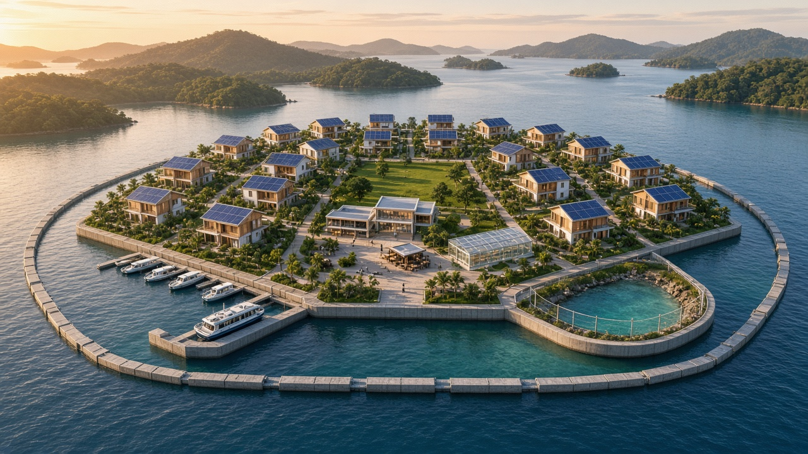
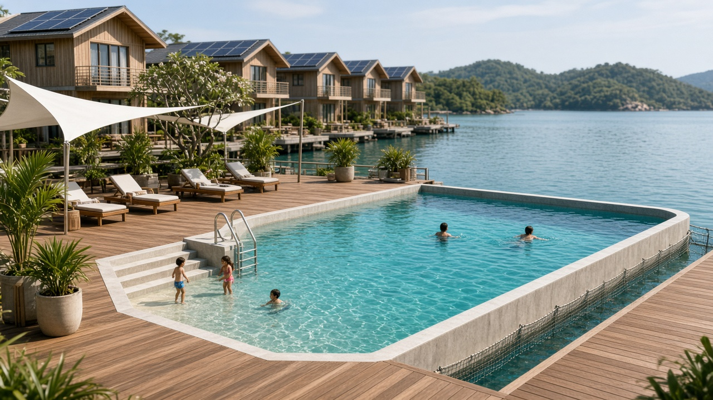
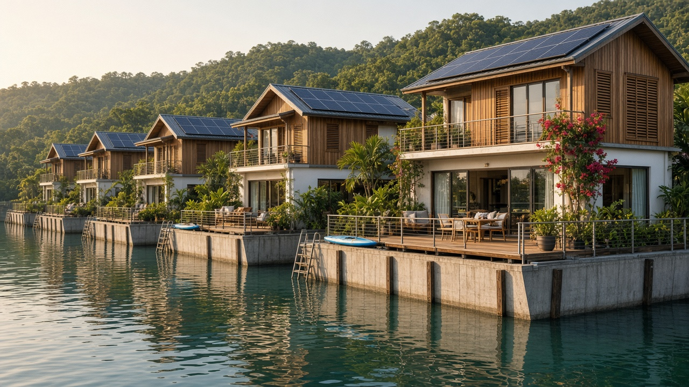
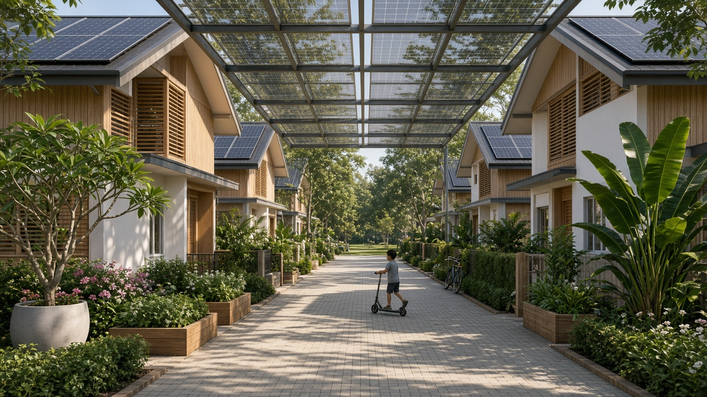
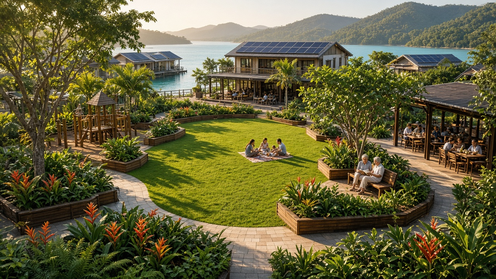
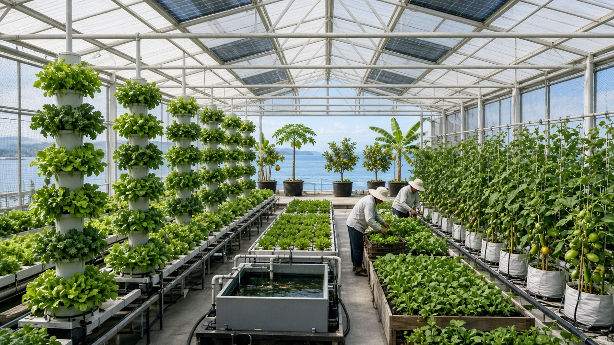
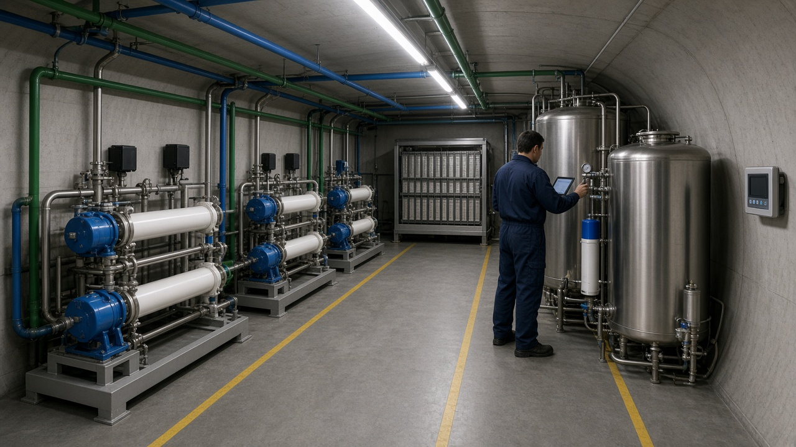
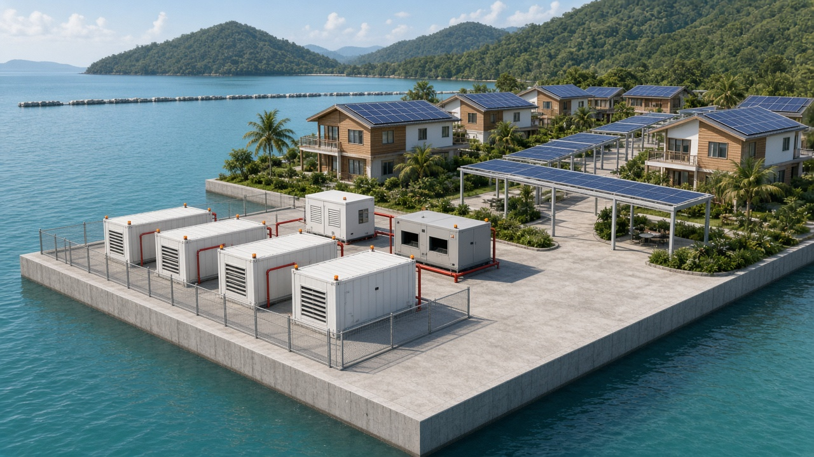

# Oceanlife: a feasibility study for a floating libertarian town

*Could a group of 20 to 30 families build their own floating country: acres of solar-powered town with houses, gardens and public space? This study works through the law, politics, engineering, systems and money, with every non-obvious claim referenced.*

*AI-generated impression of the reference village. Images throughout the study are illustrations, not design drawings.*

## The short answer

**You cannot build a floating country, but you can build a floating, self-governing village.**

- **No sovereignty at sea.** Under the UN Convention on the Law of the Sea an artificial structure has no territory of its own, and nobody may claim sovereignty over the high seas. Every attempt to declare a sea-borne state (Rose Island 1968, Minerva 1972, the Thai seapod 2019) ended with a navy.
- **What does work** is a chartered village moored in a sheltered lagoon inside a cooperating host state, under a long concession and a special-zone law that devolves civil and commercial governance.
- **The engineering is the easy part.** Nine 50 × 50 m concrete caissons, 800 kWp of rooftop solar, 2.5 MWh of batteries and off-the-shelf desalination will do it. What kills seasteads is politics, insurance and money.
- **The cost** of the reference design (25 large homes on 2 ha) is about **US$166m, or US$6.7m per family** (US$8.8m risk-adjusted), plus about US$21,000 per family per month to run. A denser **Village 40** brings that to about **US$2.9m per family** and US$10,300 a month.
- **The best host**, narrowly, is **Panama**, ahead of the UAE and Malaysia (Johor).
- **Overall verdict: Amber.** Feasible for an affluent, patient founding group that accepts autonomy *within* a host state rather than independence *from* one.

Start with the [synthesis and verdict](08-synthesis-and-verdict.md).

## Chapters

| # | Chapter | Verdict | References |
|---|---|---|---|
| 00 | [Design basis](00-design-basis.md): the starting assumptions (several later overturned) | n/a | n/a |
| 01 | [Legal status and sovereignty](01-legal.md) | Amber as a chartered zone, Red as a state | 76 |
| 02 | [Politics, governance and society](02-governance-and-society.md) | Amber | 83 |
| 03 | [Site selection and platform structure](03-site-and-structure.md) | Amber (sheltered), Red (high seas) | 108 |
| 04 | [Life-support and utility systems](04-systems.md) | Amber | 99 |
| 05 | [Cost, financing and economics](05-cost-and-economics.md) | Amber (sheltered), Red (high seas) | 83 |
| 06 | [Choosing a host country](06-host-countries.md) | Amber | 99 |
| 07 | [A cheaper, denser village](07-accessible-variant.md) | Amber | 47 |
| 08 | [Synthesis and verdict](08-synthesis-and-verdict.md) | Amber | 4 (plus chapters) |

## What it might look like

A netted seawater swimming lagoon set into the platform edge, with timber decking and a shallow children's area.

Waterfront homes along the outer edge. The concrete hull wall in the foreground stands about 3 m above the water, matching the reference design's freeboard of about 3.1 m.

A car-free interior lane of terraced townhouses, the typology Village 40 uses, under the PV canopies needed to keep the village at least 97% solar. Planting is in containers to respect the deck-load budget.

The central park, playground and community pavilion. Public open space is about 50 m² per resident in the reference design and 27.5 m² in Village 40.

The greenhouse: hydroponic towers, trellised crops and a small aquaponics tank, with a container orchard beyond. Even 2,000 m² of growing area supplies only about 6% of calories, though most fresh vegetables.

The plant room inside the hull: three small reverse-osmosis trains (one spare), potable storage, UV treatment and a membrane bioreactor for wastewater, sized for about 38 m³ of water a day.

Energy systems: LFP battery enclosures and a backup-generator housing on a fenced corner of the deck, solar on every roof, and PV canopies over paths. The study recommends wider fire separation between battery enclosures than shown here.

## How this was made, and its limits

This study was researched and drafted in November 2026 with the help of AI research agents, each working one domain from the shared [design basis](00-design-basis.md), then reconciled by a lead author. Where chapters priced the same item differently, the synthesis says which figure it uses and why.

Quality checks applied:

- Every footnote marker resolves to a reference, and every reference carries a URL and access date.
- All ~600 reference URLs were checked automatically. Dead links were replaced with Internet Archive copies. A minority of sites (mainly news and journal publishers) block automated checks; those were not individually re-opened.
- The most surprising or recent claims (for example Próspera's reduced arbitration claim, Oceanix Busan's cost growth, and the January 2026 Panama ports ruling) were re-checked against primary sources.

The images are AI-generated impressions written from the study's design, not engineering drawings.

It is **not** professional engineering, legal, tax or investment advice. Figures marked as estimates or judgements are exactly that. Corrections are welcome as issues or pull requests.
